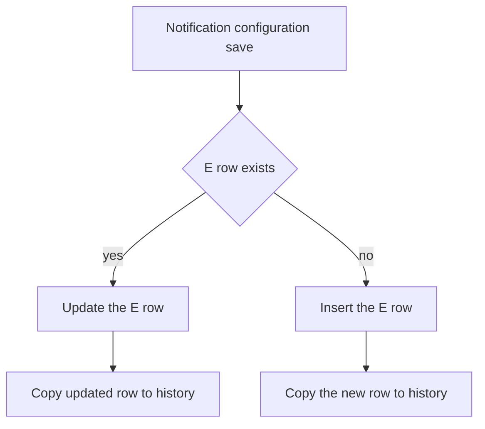

# SP_AdminMstr_EmailReminderConfiguration_SaveUpdate

## What it does

Saves separation notification reminders for one employer on `TResignationConfigurationData` with `ConfigurationType` `E`. The row covers pending-activity reminders, pre/on/post last-working-date deactivation reminders, and whether WhatsApp notification is enabled. An existing row is updated and then copied to history. A missing row is inserted and then copied.

## Parameters

| Name | Direction | What it is for |
|---|---|---|
| `@EmployerId` | in | Organisation |
| `@SendPendingActivityReminder` | in | Send a reminder for pending clearance |
| `@ReminderDaysBeforeLWD` | in | Days before last working date. Stored only when the pending reminder is on |
| `@ReminderRepeatIntervalDays` | in | Repeat interval. Stored only when the pending reminder is on |
| `@CreatedBy` | in | Employee who saved the configuration |
| `@SendPreLWDDeactivationReminder` | in | Reminder before last working date |
| `@SendOnLWDDeactivationReminder` | in | Reminder on last working date |
| `@SendPostLWDDeactivationReminder` | in | Reminder after last working date |
| `@SendDeactivationReminderDaysBefore` | in | How many days before last working date |
| `@SendPostDeactivationReminderOn` | in | Post-deactivation schedule |
| `@SendPostDeactivationReminderOnDay` | in | Day used by that schedule |
| `@IsWhatsAppNotificationEnabled` | in | Send WhatsApp as well as email |

## Call sequence

Calls no other procedures or functions.

## Callers

No other procedure or function calls this object.

## Nested

Calls no other procedures or functions.

## Steps

1. When a `ConfigurationType` `E` row exists, update the reminder and WhatsApp columns. Days before last working date and the repeat interval are stored only when `@SendPendingActivityReminder` is 1; otherwise they are set to null. `PendingActivityReminderLastRunDate` is left as it is when the repeat interval is 1, and set to null otherwise. Then copy the updated row into `TResignationConfigurationData_History`.

2. Otherwise insert a new `E` row with the parameter values and copy that row into history.

## Tables

| Table | Read or write |
|---|---|
| `TResignationConfigurationData` | read and write |
| `TResignationConfigurationData_History` | write |

## Flow

