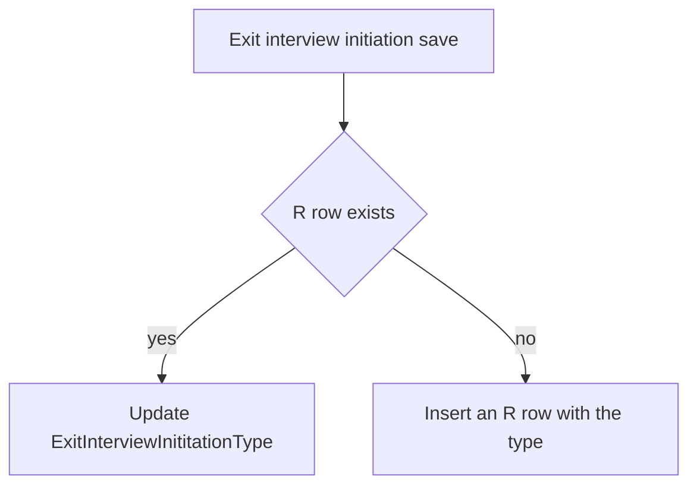

# SP_AdminMstr_ExitInterviewInitiationConfigurationData_SaveUpdate

## What it does

Stores how exit interviews are initiated. When the employer already has a resignation configuration row (`ConfigurationType` `R`), it updates `ExitInterviewInititationType` on that row. Otherwise it inserts an `R` row with backdated resignation enabled, auto approval off, and the initiation type. The script file begins with `USE [HRM-CL-Prod]` before it drops and creates the procedure. The statements inside the procedure use unqualified table names.

## Parameters

| Name | Direction | What it is for |
|---|---|---|
| `@EmployerId` | in | Organisation |
| `@CreatedBy` | in | Employee who saved the setting. Used only on insert |
| `@ExitInterviewInititationType` | in | Initiation type text |

## Call sequence

Calls no other procedures or functions.

## Callers

No other procedure or function calls this object.

## Nested

Calls no other procedures or functions.

## Steps

1. When `TResignationConfigurationData` has an `R` row for the employer, set `ExitInterviewInititationType` on that row.

2. Otherwise insert an `R` row with `EnableBackdatedResignation` 1, `EnableCurrentDate` 0, `EnableAutoApproval` 0, `IsActive` 1, `IsDeleted` 0, `EnableLastWorkingDate` 1, the created-by, and the initiation type.

## Tables

| Table | Read or write |
|---|---|
| `TResignationConfigurationData` | read and write |

## Flow

