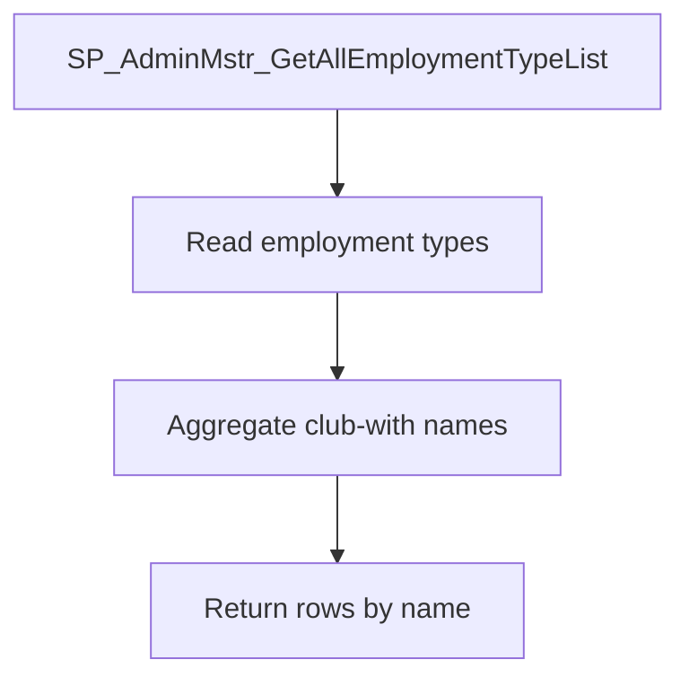

# SP_AdminMstr_GetAllEmploymentTypeList

## What it does

Lists employment types for one employer. `IsConfirmed` becomes `True` or `False`. Active employment types that this type may convert to are concatenated into `Restrictions`.

## Parameters

| Name | Direction | What it is for |
|---|---|---|
| `@Employerid` | in | Organisation whose employment types are listed |

## Call sequence

Calls no other procedures or functions.

## Callers

No other procedure or function calls this object.

`SetupMasterDAL.GetAllEmploymentTypeList` calls it from the Setup Masters page.

## Nested

Calls no other procedures or functions.

## Steps

1. Read `TMEmploymentTypes` for `@Employerid` (`SP_AdminMstr_GetAllEmploymentTypeList.sql`).
2. Left-join `TEmploymentTypeClubWith` to the active employment types named by `EmploymentTypeClubWithId`.
3. `STRING_AGG` those names into `Restrictions`.
4. Return the rows ordered by employment type name.

## Tables

| Table | Read or write |
|---|---|
| `TMEmploymentTypes` | read |
| `TEmploymentTypeClubWith` | read |

## Flow

