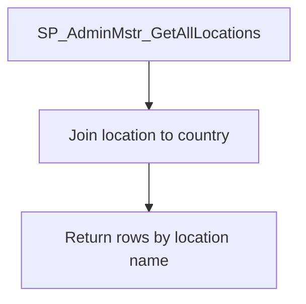

# SP_AdminMstr_GetAllLocations

## What it does

Lists locations for one employer and adds the country name from `TCOUNTRY`.

## Parameters

| Name | Direction | What it is for |
|---|---|---|
| `@Employerid` | in | Organisation whose locations are listed |

## Call sequence

Calls no other procedures or functions.

## Callers

No other procedure or function calls this object.

`SetupMasterDAL.GetAllLocations` calls it from the Setup Masters page.

## Nested

Calls no other procedures or functions.

## Steps

1. Join `TLocation` to `TCOUNTRY` on `CountryId = ID` (`SP_AdminMstr_GetAllLocations.sql`).
2. Keep rows for `@Employerid`.
3. Return them ordered by `LocationName`.

## Tables

| Table | Read or write |
|---|---|
| `TLocation` | read |
| `TCOUNTRY` | read |

## Flow

