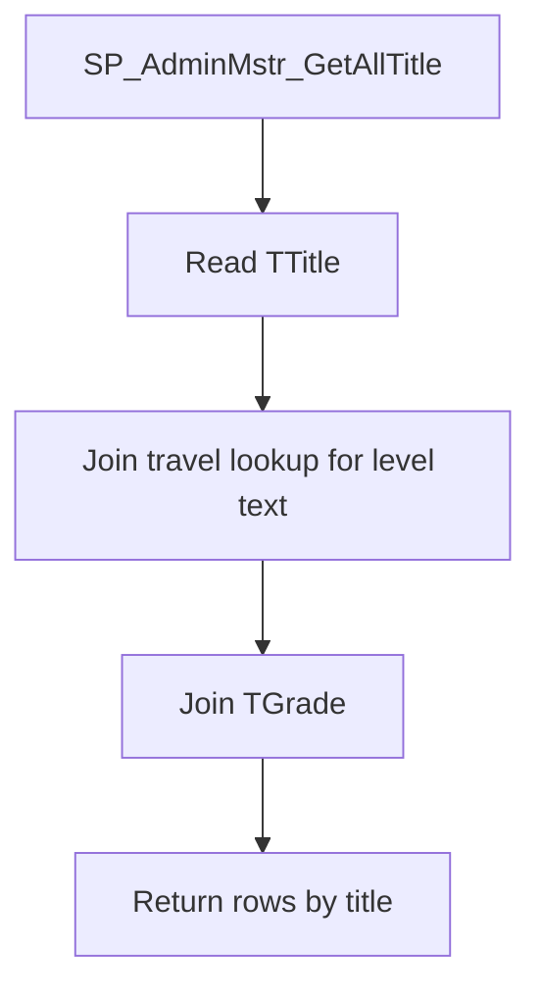

# SP_AdminMstr_GetAllTitle

## What it does

Lists designations for one employer. It joins `TTitle` to the travel-and-expense lookup for the designation-level text, and to `TGrade` for the grade name and band.

## Parameters

| Name | Direction | What it is for |
|---|---|---|
| `@Employerid` | in | Organisation whose designations are listed |

## Call sequence

Calls no other procedures or functions.

## Callers

No other procedure or function calls this object.

`SetupMasterDAL.GetAllTitleList` calls it from the Setup Masters page.

## Nested

Calls no other procedures or functions.

## Steps

1. Read `TTitle` for `@Employerid` (`SP_AdminMstr_GetAllTitle.sql`).
2. Left-join `[TravelNExpense].[dbo].Tlookup` on `DesignationLevel = Lookup_ID` and return `Lookup_Text` as `DesignationLevel`.
3. Left-join `TGrade` on `GradeId` and return `GradeName` and `GradeBand`.
4. Order by `Title`.

## Tables

| Table | Read or write |
|---|---|
| `TTitle` | read |
| `TGrade` | read |
| `[TravelNExpense].[dbo].Tlookup` | read |

## Flow

