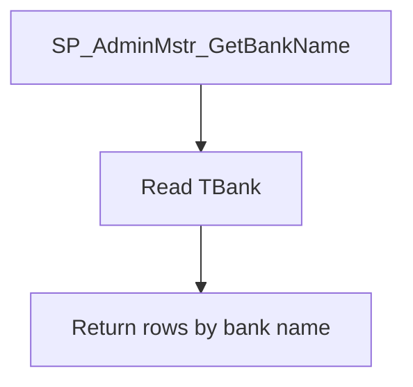

# SP_AdminMstr_GetBankName

## What it does

Lists distinct banks for one employer: id, name, and active flag, ordered by name.

## Parameters

| Name | Direction | What it is for |
|---|---|---|
| `@Employerid` | in | Organisation whose banks are listed |

## Call sequence

Calls no other procedures or functions.

## Callers

No other procedure or function calls this object.

`SetupMasterDAL.GetBankNames` calls it from the Setup Masters page.

## Nested

Calls no other procedures or functions.

## Steps

1. Read distinct `BankId`, `BankName`, and `IsActive` from `TBank` for `@Employerid` (`SP_AdminMstr_GetBankName.sql`).
2. Order by `BankName`.

## Tables

| Table | Read or write |
|---|---|
| `TBank` | read |

## Flow

