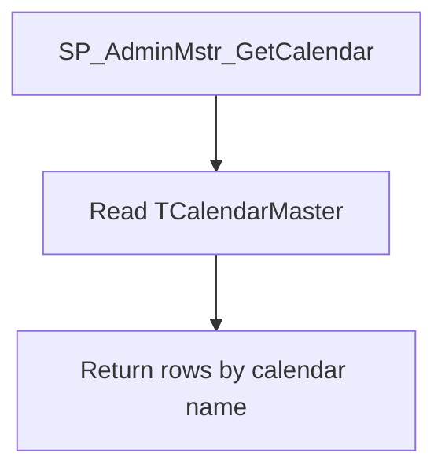

# SP_AdminMstr_GetCalendar

## What it does

Lists every calendar for one employer. It reads `TCalendarMaster` and turns the bit flags into Yes/No text, including whether a holiday takes precedence over a weekly off.

## Parameters

| Name | Direction | What it is for |
|---|---|---|
| `@Employerid` | in | Organisation whose calendars are listed |

## Call sequence

Calls no other procedures or functions.

## Callers

No other procedure or function calls this object.

`SetupMasterDAL.GetCalendarMasterDetails` calls it from the Setup Masters page. That caller is application code.

## Nested

Calls no other procedures or functions.

## Steps

1. Read `TCalendarMaster` for `@Employerid` (`SP_AdminMstr_GetCalendar.sql`).
2. Map `IsActive` to `Y` or `N`, and the holiday-on-weekly-off flags to Yes, No, or NA.
3. Return the rows ordered by `CalendarName`.

## Tables

| Table | Read or write |
|---|---|
| `TCalendarMaster` | read |

## Flow

