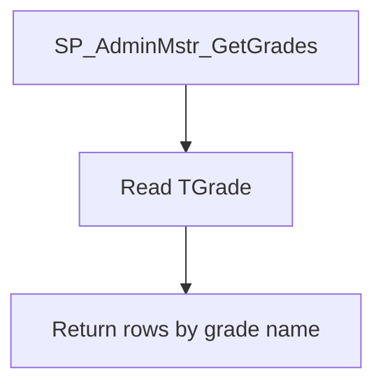

# SP_AdminMstr_GetGrades

## What it does

Lists grades for one employer: id, name, description, band, and active flag.

## Parameters

| Name | Direction | What it is for |
|---|---|---|
| `@Employerid` | in | Organisation whose grades are listed |

## Call sequence

Calls no other procedures or functions.

## Callers

No other procedure or function calls this object.

`SetupMasterDAL.GetGrades` calls it from the Setup Masters page.

## Nested

Calls no other procedures or functions.

## Steps

1. Read `TGrade` for `@Employerid` (`SP_AdminMstr_GetGrades.sql`).
2. Return the rows ordered by `GradeName`.

## Tables

| Table | Read or write |
|---|---|
| `TGrade` | read |

## Flow

