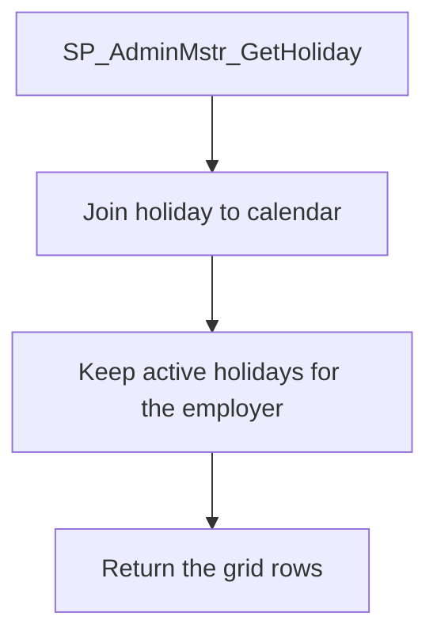

# SP_AdminMstr_GetHoliday

## What it does

Lists active holidays for one employer, with the calendar name. Optional holidays are labelled Optional. Every other `IsOptional` value is labelled Compulsory. Half-day and minimum-attendance flags are returned as Y or N.

## Parameters

| Name | Direction | What it is for |
|---|---|---|
| `@Employerid` | in | Organisation whose holidays are listed |

## Call sequence

Calls no other procedures or functions.

## Callers

No other procedure or function calls this object.

`SetupMasterDAL.GetHolidayMasterDetails` calls it from the Setup Masters page.

## Nested

Calls no other procedures or functions.

## Steps

1. Join `THolidayMaster` to `TCalendarMaster` on calendar id and employer (`SP_AdminMstr_GetHoliday.sql`).
2. Keep rows for `@Employerid` whose holiday `IsActive` is 1.
3. Return them ordered by calendar name, then holiday date descending by year and ascending by month and day.

## Tables

| Table | Read or write |
|---|---|
| `THolidayMaster` | read |
| `TCalendarMaster` | read |

## Flow

