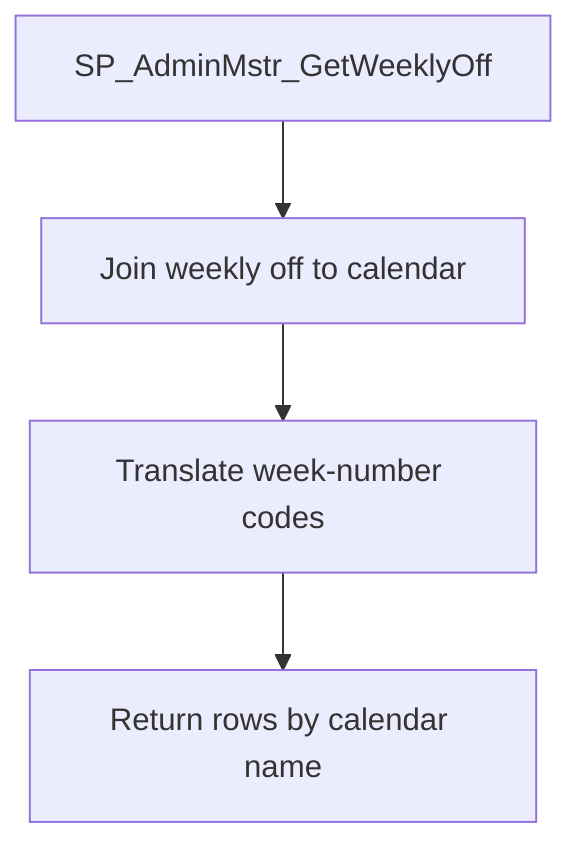

# SP_AdminMstr_GetWeeklyOff

## What it does

Lists weekly-off rows for one employer and adds the calendar name. Week-number codes such as `All`, `WOL`, `EX1`, and `WO135` are returned again as display text (`All Weeks`, `Last Week`, and so on).

## Parameters

| Name | Direction | What it is for |
|---|---|---|
| `@Employerid` | in | Organisation whose weekly offs are listed |

## Call sequence

Calls no other procedures or functions.

## Callers

No other procedure or function calls this object.

`SetupMasterDAL.GetWeeklyOffMasterDetails` calls it from the Setup Masters page.

## Nested

Calls no other procedures or functions.

## Steps

1. Join `TWeeklyOffMaster` to `TCalendarMaster` on calendar id, limited to `@Employerid` (`SP_AdminMstr_GetWeeklyOff.sql`).
2. Translate `WeekNumber` into `WeekNumberText`.
3. Return the rows ordered by calendar name.

## Tables

| Table | Read or write |
|---|---|
| `TWeeklyOffMaster` | read |
| `TCalendarMaster` | read |

## Flow

