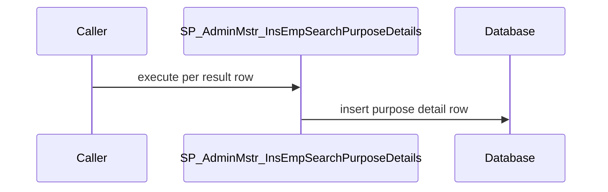
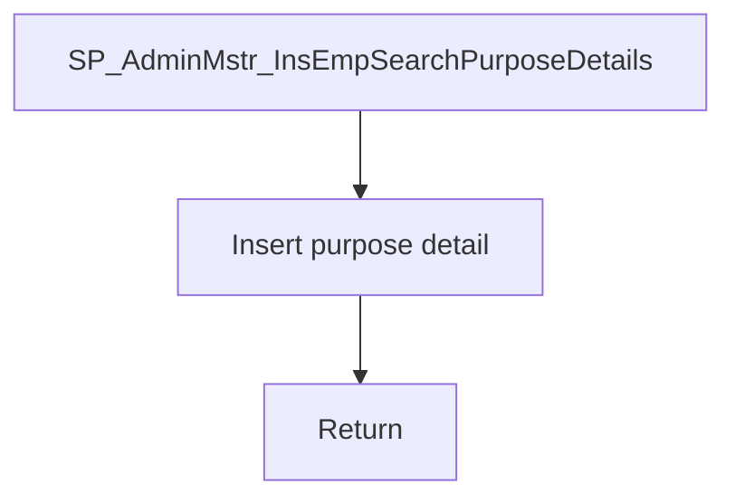

# SP_AdminMstr_InsEmpSearchPurposeDetails

## What it does

Inserts one classic Search Employee “search purpose” audit row linking who searched, who was returned, and which purpose (or free text) was chosen when that feature flag is enabled.

## Parameters

| Name | Direction | What it is for |
|---|---|---|
| `@SearchedBy` | in | Logged-in employee who ran the search |
| `@SearchedFor` | in | Employee id from the result row |
| `@SearchPurposeId` | in | Purpose master id when selected |
| `@SearchPurposeText` | in | Free-text purpose when applicable |
| `@EmployerID` | in | Employer of the search session |

## Call sequence

## Callers

Application caller: classic `SearchEmployee.aspx.cs` `insertEmployeeSearchPurposeData` → `SetupMasterDAL.InsertEmployeeSearchPurposeDetails`.

## Nested

None.

## Steps

1. Script is `HRMS-DATABASE/HRMS/STOREPROCEDURE/SP_AdminMstr_InsEmpSearchPurposeDetails.sql`.
2. Insert the searched-by / searched-for / purpose payload into the search-purpose details table.

## Tables

| Table | Read or write |
|---|---|
| `dbo.TEmployeeSearchPurposeDetails` | write |

## Flow

