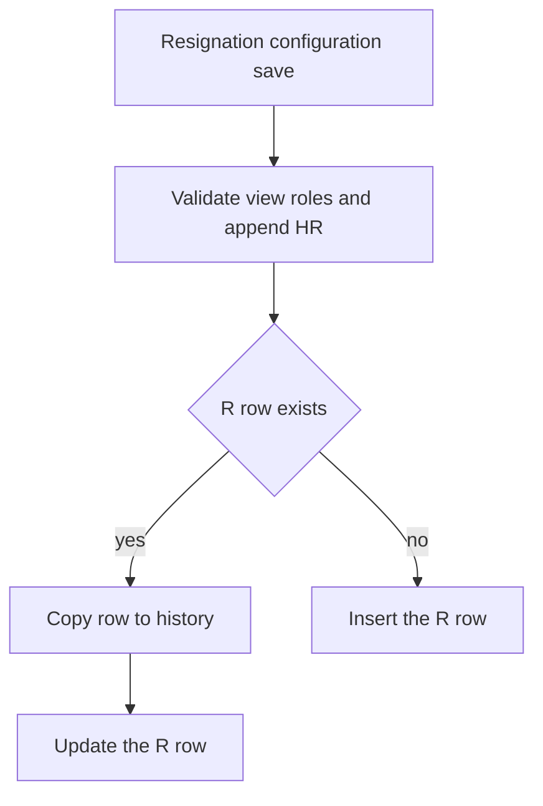

# SP_AdminMstr_ResignationConfigurationData_SaveUpdate

## What it does

Saves the resignation side of separation configuration for one employer. The row is `TResignationConfigurationData` with `ConfigurationType` `R`. An existing row is copied to history and then updated. A missing row is inserted. The active HR role is appended to several role lists when they are not empty, and used as the whole list when they are empty.

## Parameters

| Name | Direction | What it is for |
|---|---|---|
| `@EmployerId` | in | Organisation |
| `@EnableBackdated` | in | Allow a backdated resignation date |
| `@EnableCurrentDate` | in | Allow the current date |
| `@AddLastWorkingDateRole` | in | Roles that may set last working date |
| `@AddResignationReasonsRole` | in | Roles that may set resignation reasons |
| `@AddNoticePeriodTypeRole` | in | Roles that may set notice-period type |
| `@SuggestReplacementRole` | in | Roles that may suggest a replacement |
| `@EnableAutoApproval` | in | Auto approve or reject |
| `@EnableLastWorkingDate` | in | Last-working-date behaviour |
| `@AutoApproveReject` | in | `A` or `R` when auto approval is on |
| `@AutoApprovalRejectionInDays` | in | Days before auto approval or rejection |
| `@CreatedBy` | in | Employee who saved the configuration |
| `@ViewResignationCommentsRole` | in | Roles that may view resignation comments |
| `@ViewResignationCommentsOnPullbackRole` | in | Roles that may view pullback comments |
| `@BackdatedResignationDays` | in | How far back a resignation date may go. Optional |
| `@AllowBackdatedLWD` | in | Allow a backdated last working date. Default 0 |
| `@AllowClearanceDueDateOnWeekendHoliday` | in | Allow clearance due dates on a weekend or holiday. Default 0 |
| `@EnableAutoDeactivationOnResignation` | in | Turn on automatic deactivation |
| `@AutoDeactivateOnAfterResignation` | in | When automatic deactivation runs |
| `@OnResignationAutoDeactivateAfterDays` | in | Days after which deactivation runs |
| `@RestrictResignationDateOnWeeklyOff` | in | Block a resignation date on a weekly off. Default 0 |
| `@NoticePeriodEndDateAdjustment` | in | How the notice-period end date is adjusted |
| `@PendingActivitySelfViewRole` | in | Roles that see pending activities for themselves. Optional |
| `@PendingActivityApprovalViewRole` | in | Roles that see pending activities during approval. Optional |
| `@PendingActivityAdminViewRole` | in | Admin roles that see pending activities. Optional |
| `@LeaveBalanceViewRole` | in | Roles that see leave balance. Optional |
| `@RevisedLWDViewRole` | in | Roles that see the revised last working date. Optional |
| `@NoticePeriodLeavesViewRole` | in | Roles that see notice-period leaves. Optional |

## Call sequence

Calls no other procedures or functions.

## Callers

No other procedure or function calls this object.

## Nested

Calls no other procedures or functions.

## Steps

1. Throw 50001 when `@LeaveBalanceViewRole`, `@RevisedLWDViewRole`, or `@NoticePeriodLeavesViewRole` is an empty string after trim. A null value is left alone.

2. If a role list contains `-99`, replace that list with `-99`. Otherwise strip spaces.

3. Read the active, not-deleted HR `RoleId` from `TRoleManagement` for the employer. If a role parameter is empty, set it to that HR role. If it already has values, append the HR role.

4. When a `ConfigurationType` `R` row exists, copy it into `TResignationConfigurationData_History`, then update the live row. `AddApprovedLastWorkingDateRole` is set to the HR role. The three optional view-role columns keep their current value when the parameter is null. `FieldVisibilityAutoResetOn` is set to null.

5. When no `R` row exists, insert one. This branch does not write history.

## Tables

| Table | Read or write |
|---|---|
| `TRoleManagement` | read |
| `TResignationConfigurationData` | read and write |
| `TResignationConfigurationData_History` | write when an `R` row already exists |

## Flow

