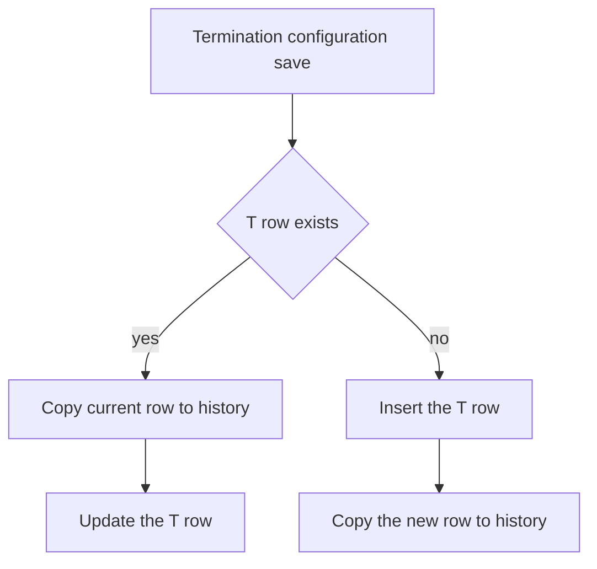

# SP_AdminMstr_TerminationConfigurationData_SaveUpdate

## What it does

Saves termination configuration for one employer on `TResignationConfigurationData` with `ConfigurationType` `T`. An existing row is copied to history and then updated. A new row is inserted and then copied to history.

## Parameters

| Name | Direction | What it is for |
|---|---|---|
| `@EmployerId` | in | Organisation |
| `@AllowBackdatedLWD` | in | Allow a backdated last working date |
| `@CreatedBy` | in | Employee who saved the configuration. Also stored as `ModifiedBy` |
| `@EnableAutoDeactivationOnTermination` | in | Turn on automatic deactivation after termination |
| `@AutoDeactivateOnAfterTermination` | in | When automatic deactivation runs |
| `@OnTerminationAutoDeactivateAfterDays` | in | Days after which deactivation runs |

## Call sequence

Calls no other procedures or functions.

## Callers

No other procedure or function calls this object.

## Nested

Calls no other procedures or functions.

## Steps

1. When a `ConfigurationType` `T` row exists for the employer, insert the current values into `TResignationConfigurationData_History`, then update `AllowBackdatedLWD`, the auto-deactivation columns, `ModifiedBy`, and `ModifiedDate`.

2. Otherwise insert a new `T` row and copy that new row into `TResignationConfigurationData_History`.

## Tables

| Table | Read or write |
|---|---|
| `TResignationConfigurationData` | read and write |
| `TResignationConfigurationData_History` | write |

## Flow

