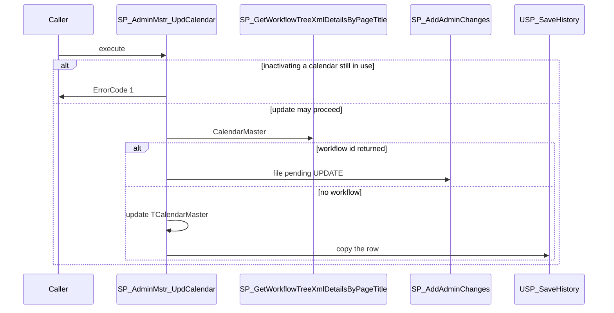
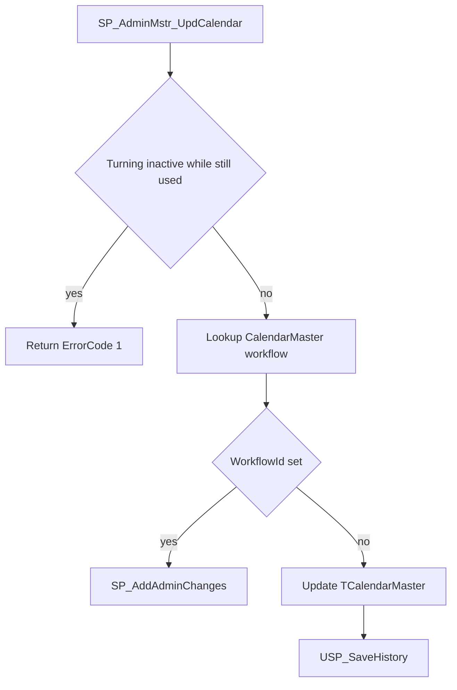

# SP_AdminMstr_UpdCalendar

## What it does

Updates one calendar, or holds that update for admin approval. Turning an active calendar inactive is refused when the calendar is still used by an employee, employee history, an active holiday, or a weekly off. The procedure then loads the workflow for module page `CalendarMaster` on the calendar's employer.

## Parameters

| Name | Direction | What it is for |
|---|---|---|
| `@CalendarId` | in | Calendar to update |
| `@CalendarName` | in | New name |
| `@CalendarDesc` | in | New description |
| `@IsActive` | in | New active flag |
| `@UpdatedBy` | in | Administrator |
| `@AllowHolidayOnWeeklyOff` | in | Holiday may fall on a weekly off. Default 0 |
| `@IsHolidayPrecendenceOverWeeklyOff` | in | Holiday wins over weekly off. Default 0 |
| `@IsWeeklyOffApplicable` | in | Weekly off applies. Default 0 |

All parameters are inputs.

## Call sequence

## Callers

No other procedure or function calls this object.

`SetupMasterDAL.UpdateCalendarMaster` calls it from the Setup Masters page.

## Nested

| Object | Kind | When | Page |
|---|---|---|---|
| `SP_GetWorkflowTreeXmlDetailsByPageTitle` | procedure | after the in-use check | [SP_GetWorkflowTreeXmlDetailsByPageTitle](/docs/database/hrms/SP_GetWorkflowTreeXmlDetailsByPageTitle) |
| `SP_AddAdminChanges` | procedure | when that lookup returns a workflow id | [SP_AddAdminChanges](/docs/database/hrms/SP_AddAdminChanges) |
| `USP_SaveHistory` | procedure | when no workflow id is returned, after the update | No page yet |

## Steps

1. Read the current `IsActive` from `TCalendarMaster` (`SP_AdminMstr_UpdCalendar.sql`).
2. When the row is active and `@IsActive` is 0, count uses in `TEmployeeInfo`, `TEmployeeInfoHistory`, active `THolidayMaster`, and `TWeeklyOffMaster`. If any count is positive, return `ErrorCode` 1 and stop.
3. Read the current name and `Employerid` for the action label.
4. `EXEC SP_GetWorkflowTreeXmlDetailsByPageTitle` for `CalendarMaster` and that employer.
5. When a workflow id is returned, `EXEC SP_AddAdminChanges` with action `UPDATE` and `@CalendarId` as the table id.
6. Otherwise update `TCalendarMaster` and `EXEC USP_SaveHistory` with action `U`.

## Tables

| Table | Read or write |
|---|---|
| `TCalendarMaster` | read, and write when no workflow |
| `TEmployeeInfo` | read, when inactivating |
| `TEmployeeInfoHistory` | read, when inactivating |
| `THolidayMaster` | read, when inactivating |
| `TWeeklyOffMaster` | read, when inactivating |
| `TAdminChangesApprovals` | write, through `SP_AddAdminChanges` |
| `TAdminChangesApprovalDetails` | write, through `SP_AddAdminChanges` |

## Flow

