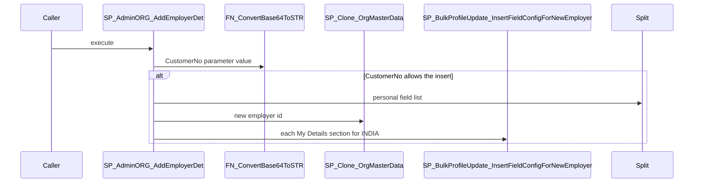
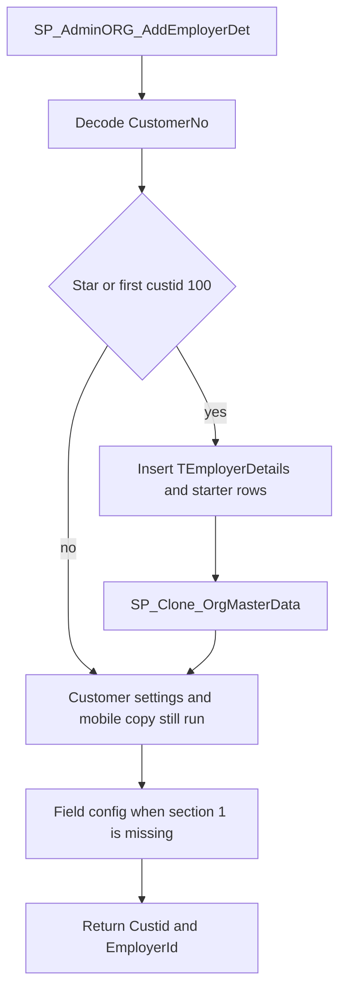

# SP_AdminORG_AddEmployerDet

## What it does

Creates one organisation. It allocates the next EmployerId, inserts TEmployerDetails only when the decoded CustomerNo parameter allows it, copies starter configuration from employer 0 and customer C00000, and returns the new customer number and employer id.

## Parameters

| Name | Direction | What it is for |
|---|---|---|
| `@EmployerName` | in | Organisation name |
| `@ContactAddress` | in | Contact address |
| `@PermanentAddress` | in | Permanent address |
| `@OfficeContactName` | in | Office contact name |
| `@EmployerTIN` | in | Tax id |
| `@EmployerFNPFID` | in | PF number |
| `@ContactNumber` | in | Contact number |
| `@FaxNumber` | in | Fax number |
| `@OrganizationUrl` | in | Organisation URL |
| `@BranchNumber` | in | Branch number |
| `@BankAccountNumber` | in | Bank account number |
| `@BankID` | in | Bank id |
| `@EmployerLogo` | in | Website logo bytes, including a cropped image |
| `@AttendanceCaptureType` | in | Attendance modes. Blank becomes A,B,D,G,M |
| `@IndustryTypeId` | in | Industry. Default null |
| `@LicenseCount` | in | Licence count text |
| `@LicenseKey` | in | Licence key text |
| `@ParentEmployerID` | in | Parent employer. Used to walk the root |
| `@NotificationSenderEmail` | in | Sender email |
| `@PasswordExpires` | in | Password expiry days |
| `@PasswordChangelimit` | in | Password change limit |
| `@PreventPasswords` | in | Password history count |
| `@FailedAttempts` | in | Failed login attempts |
| `@AccessControlReportFrequency` | in | Access-control report frequency |
| `@PreventPersonalFields` | in | Personal-field prevention flag text |
| `@PasswordExpirationAlert` | in | Password expiry alert days |
| `@IsDeletePersonalFields` | in | Whether personal fields are purged |
| `@PersonalFieldsDeleteDuration` | in | Purge duration |
| `@PersonalFields` | in | Comma-separated personal field ids |
| `@CreatedBy` | in | Creating user |
| `@SearchPurpose` | in | Search-purpose flag |
| `@IsDeleteActivityLog` | in | Whether activity log is purged |
| `@DeleteActivityLogDuration` | in | Activity-log purge duration |
| `@IsIPBasedAttendance` | in | IP-based attendance flag |
| `@TimeZone` | in | Time zone display name |
| `@TimeZoneId` | in | Time zone id |
| `@OrgDlEmail` | in | Organisation distribution list |
| `@NumberOfDigitsEmpNumber` | in | Employment-number length |
| `@IsPrecedWithZeros` | in | Pad employment numbers with zeros |
| `@IsCrossReportingApplicable` | in | Cross reporting Y or N |
| `@CountryId` | in | Country |
| `@IsSequenceWithRootOrganization` | in | Y copies employment-number rules from the root |
| `@BusinessRelationship` | in | Business relationship text |
| `@NoticePeriodBasedOn` | in | Notice-period basis |
| `@PayrollCutOffDay` | in | Payroll cut-off day |
| `@StartDayOfWeek` | in | Week start day |
| `@IsAccountLock` | in | Account lock flag |
| `@StartMonthOfCalenderYear` | in | Calendar year start month |
| `@HeaderHeight` | in | Header height. Default 84 |
| `@FooterHeight` | in | Footer height. Default 70 |
| `@Opacity` | in | Watermark opacity |
| `@UsePayrollCycleForLAFrequency` | in | Use payroll cycle for leave frequency |
| `@BccRecipientsForBirthdayEmail` | in | Birthday email BCC |
| `@BccRecipientsForWelcomeEmail` | in | Welcome email BCC |
| `@BccRecipientsForWorkAnniversaryEmail` | in | Work-anniversary email BCC |
| `@DigitalIdCardBasedOn` | in | Digital id card criteria |

## Call sequence

## Callers

Procedures and functions that call this object.

No other procedure or function calls this object.

## Nested

| Object | Kind | When | Page |
|---|---|---|
| `FN_ConvertBase64ToSTR` | function | decode TParameters.CustomerNo before the insert gate | [FN_ConvertBase64ToSTR](/docs/database/hrms/FN_ConvertBase64ToSTR) |
| `Split` | function | split @PersonalFields into TDeletePersonalFields rows | [Split](/docs/database/hrms/Split) |
| `SP_Clone_OrgMasterData` | procedure | after the employer row is inserted | [SP_Clone_OrgMasterData](/docs/database/hrms/SP_Clone_OrgMasterData) |
| `SP_BulkProfileUpdate_InsertFieldConfigForNewEmployer` | procedure | once per My Details section when field config is missing | [SP_BulkProfileUpdate_InsertFieldConfigForNewEmployer](/docs/database/hrms/SP_BulkProfileUpdate_InsertFieldConfigForNewEmployer) |

## Steps

1. Read TParameters where ParameterKey is CustomerNo and decode ParameterValue with FN_ConvertBase64ToSTR.

2. Set the new employer id to one more than the current maximum EmployerId.

3. When a parent id is greater than 0, walk ParentEmployerid upward to a root employer id. When IsSequenceWithRootOrganization is Y, copy that root's employment-number length and zero-padding.

4. Insert TEmployerDetails only when the decoded value is * , or is 100 and no employer already has custid 100. isdeleted is 0. A blank attendance list is stored as A,B,D,G,M. Header and footer heights and opacity use ISNULL defaults.

5. Inside that same gate, insert TDeletePersonalFields from dbo.Split of @PersonalFields, copy birthday and work-anniversary rows from Tevents for employer 0, insert a default RRSApprover role, insert an AllottedDiskSizeInBytes parameter, set custid to 100 or to C plus a five-digit employer id, execute SP_Clone_OrgMasterData, and set RootEmployerId to the new id when it is still null.

6. After that gate, copy TCustomerSettings from employer 0 onto the new customer id and employer id, and copy tMobileCustomer from customer C00000, replacing C00000 inside LogoURL.

7. When TEmployeeDetail_Fields has no section 1 row for that customer, call SP_BulkProfileUpdate_InsertFieldConfigForNewEmployer for each listed My Details section with country INDIA, set CountryID 0 on segment and system fields, rebuild TemployeeDetail_Fields_Grouping, and update field groups and DependOnField.

8. Return one row with Custid and EmployerId. Those variables are selected even when the employer insert gate did not run.

## Tables

| Table | Read or write |
|---|---|
| `TParameters` | read |
| `TEmployerDetails` | read and write |
| `TDeletePersonalFields` | write |
| `Tevents` | read and write |
| `TRoleManagement` | write |
| `TCustomerSettings` | read and write |
| `tMobileCustomer` | read and write |
| `TEmployeeDetail_Fields` | read and write |
| `TemployeeDetail_Fields_Grouping` | write |
| `TEmployeeDetail_Section` | read |

## Flow

