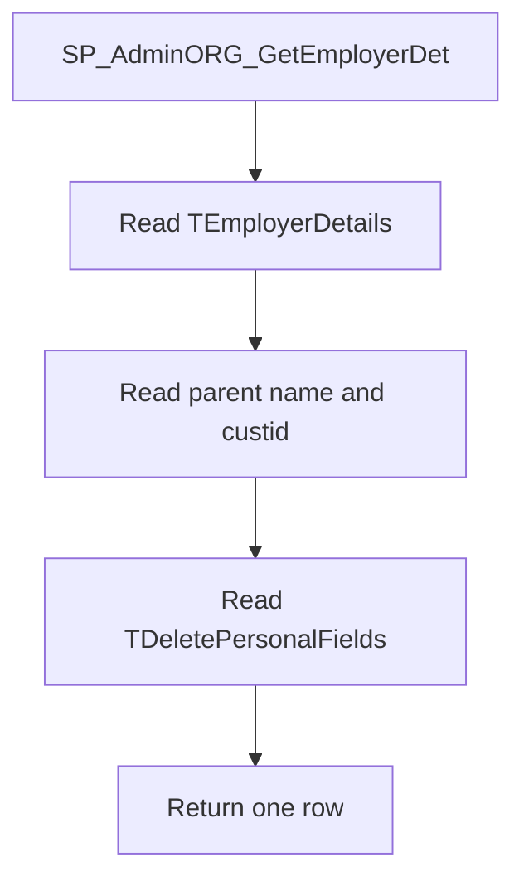

# SP_AdminORG_GetEmployerDet

## What it does

Returns one employer row for the Add Organization edit form, including the website logo, parent customer id and name, the personal-field purge list, letterhead paths, and the organisation settings the form binds.

## Parameters

| Name | Direction | What it is for |
|---|---|---|
| `@employerID` | in | Employer to load |

## Call sequence

Calls no other procedures or functions.

## Callers

Procedures and functions that call this object.

No other procedure or function calls this object.

## Nested

Calls no other procedures or functions.

## Steps

1. Select the employer columns from TEmployerDetails for @employerID.

2. Look up the parent row's custid and EmployerName by ParentEmployerid. Those lookups are not foreign keys in the statement.

3. Build PersonalFields with STUFF and FOR XML PATH over TDeletePersonalFields for the same employer.

4. Return header, footer, and watermark paths, notice-period basis, payroll and calendar settings, letterhead sizes, opacity, email BCC lists, digital-id basis, and IndustryTypeId.

## Tables

| Table | Read or write |
|---|---|
| `TEmployerDetails` | read |
| `TDeletePersonalFields` | read |

## Flow

