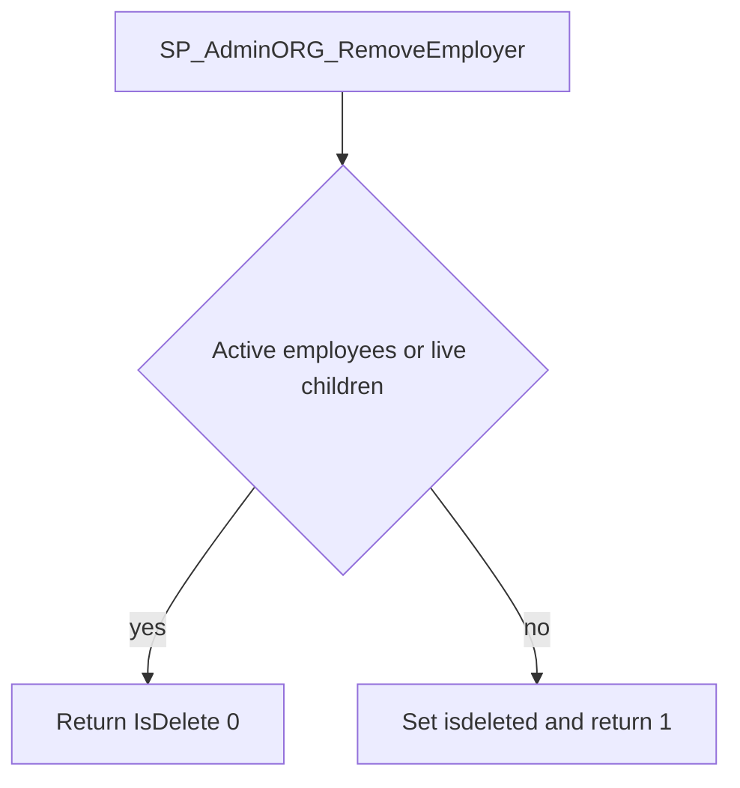

# SP_AdminORG_RemoveEmployer

## What it does

Soft-deletes an organisation only when it has no active employees and no child organisations that are not already deleted. Otherwise it returns 0 and leaves the row.

## Parameters

| Name | Direction | What it is for |
|---|---|---|
| `@employerId` | in | Employer to delete |

## Call sequence

Calls no other procedures or functions.

## Callers

Procedures and functions that call this object.

No other procedure or function calls this object.

## Nested

Calls no other procedures or functions.

## Steps

1. Count active employees by joining TEmployeeInfo and TEmployee on the employer, with TEmployee.IsActive equal to Y.

2. Count TEmployerDetails rows whose ParentEmployerid is this employer and isdeleted is 0.

3. When both counts are 0, set isdeleted to 1 and return IsDelete 1. Otherwise return IsDelete 0.

## Tables

| Table | Read or write |
|---|---|
| `TEmployeeInfo` | read |
| `TEmployee` | read |
| `TEmployerDetails` | read and write |

## Flow

