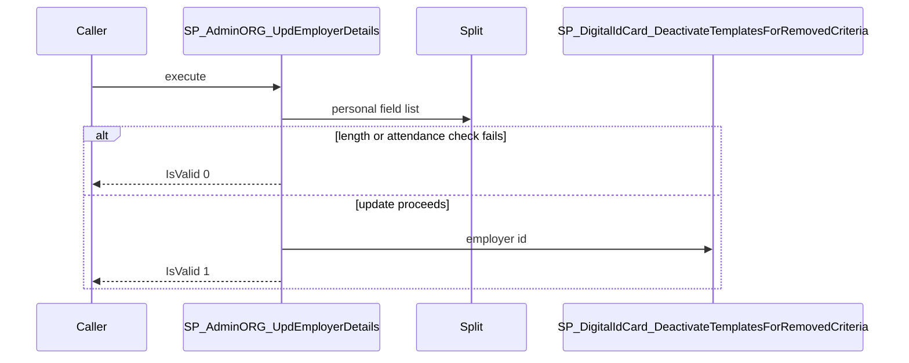
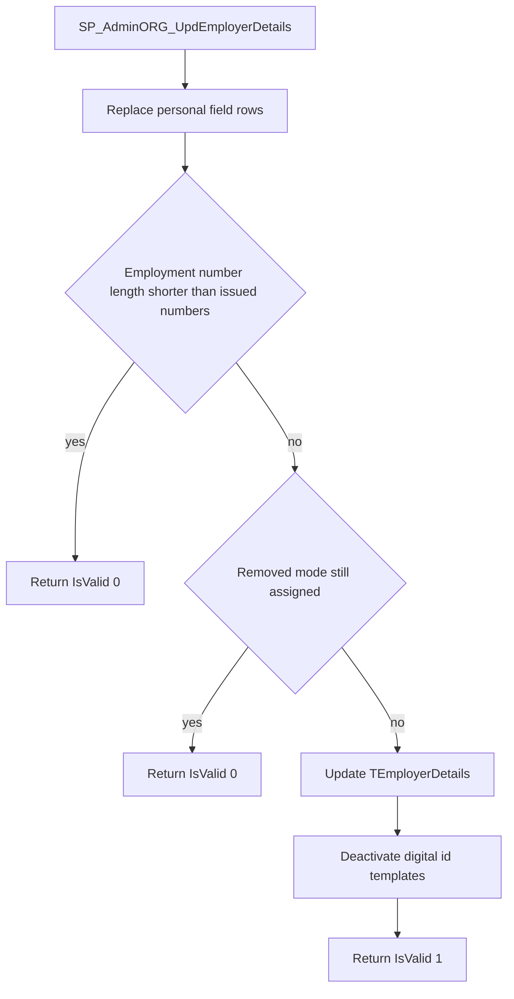

# SP_AdminORG_UpdEmployerDetails

## What it does

Updates one organisation. It replaces the personal-field purge list, then refuses the update when the employment-number length would be shorter than numbers already issued or when an attendance mode being removed is still the only mode on active employees. A successful update also deactivates notice-period setups when that basis changes, and deactivates digital-id templates whose criteria were removed.

## Parameters

| Name | Direction | What it is for |
|---|---|---|
| `@employeerId` | in | Employer to update. The parameter name is spelled with an extra e |
| `@EmployerName` | in | Organisation name |
| `@ContactAddress` | in | Contact address |
| `@PermanentAddress` | in | Permanent address |
| `@OfficeContactName` | in | Office contact name |
| `@EmployerTIN` | in | Tax id |
| `@EmployerFNPFID` | in | PF number |
| `@ContactNumber` | in | Contact number |
| `@FaxNumber` | in | Fax number |
| `@OrganizationUrl` | in | Organisation URL |
| `@BranchNumber` | in | Branch number |
| `@BankAccountNumber` | in | Bank account number |
| `@BankID` | in | Bank id |
| `@EmployerLogo` | in | Website logo. An empty value leaves the stored logo |
| `@AttendanceCaptureType` | in | New attendance mode list |
| `@IndustryTypeId` | in | Industry |
| `@LicenseCount` | in | Licence count text |
| `@LicenseKey` | in | Licence key text |
| `@ParentEmployerid` | in | Parent employer |
| `@NotificationSenderEmail` | in | Sender email |
| `@PasswordExpires` | in | Password expiry days |
| `@PasswordChangelimit` | in | Password change limit |
| `@PreventPasswords` | in | Password history count |
| `@FailedAttempts` | in | Failed login attempts |
| `@AccessControlReportFrequency` | in | Access-control report frequency |
| `@PreventPersonalFields` | in | Personal-field prevention flag text |
| `@PasswordExpirationAlert` | in | Password expiry alert days |
| `@IsDeletePersonalFields` | in | Whether personal fields are purged |
| `@PersonalFieldsDeleteDuration` | in | Purge duration |
| `@PersonalFields` | in | Comma-separated personal field ids |
| `@CreatedBy` | in | User recorded on the purge rows |
| `@SearchPurpose` | in | Search-purpose flag |
| `@IsDeleteActivityLog` | in | Whether activity log is purged |
| `@DeleteActivityLogDuration` | in | Activity-log purge duration |
| `@IsIPBasedAttendance` | in | IP-based attendance flag |
| `@TimeZone` | in | Time zone display name |
| `@TimeZoneId` | in | Time zone id |
| `@OrgDlEmail` | in | Organisation distribution list |
| `@NumberOfDigitsEmpNumber` | in | Employment-number length |
| `@IsPrecedWithZeros` | in | Pad employment numbers |
| `@IsCrossReportingApplicable` | in | Cross reporting Y or N |
| `@CountryId` | in | Country |
| `@IsSequenceWithRootOrganization` | in | Sequence-with-root flag |
| `@BusinessRelationship` | in | Business relationship text |
| `@NoticePeriodBasedOn` | in | Notice-period basis |
| `@PayrollCutOffDay` | in | Payroll cut-off day |
| `@StartDayOfWeek` | in | Week start day |
| `@IsAccountLock` | in | Account lock flag |
| `@StartMonthOfCalenderYear` | in | Calendar year start month |
| `@HeaderHeight` | in | Header height |
| `@FooterHeight` | in | Footer height |
| `@Opacity` | in | Watermark opacity |
| `@UsePayrollCycleForLAFrequency` | in | Use payroll cycle for leave frequency |
| `@BccRecipientsForBirthdayEmail` | in | Birthday email BCC |
| `@BccRecipientsForWelcomeEmail` | in | Welcome email BCC |
| `@BccRecipientsForWorkAnniversaryEmail` | in | Work-anniversary email BCC |
| `@DigitalIdCardBasedOn` | in | Digital id card criteria |

## Call sequence

## Callers

Procedures and functions that call this object.

No other procedure or function calls this object.

## Nested

| Object | Kind | When | Page |
|---|---|---|
| `Split` | function | rebuild TDeletePersonalFields from @PersonalFields | [Split](/docs/database/hrms/Split) |
| `SP_DigitalIdCard_DeactivateTemplatesForRemovedCriteria` | procedure | after the employer update | [SP_DigitalIdCard_DeactivateTemplatesForRemovedCriteria](/docs/database/hrms/SP_DigitalIdCard_DeactivateTemplatesForRemovedCriteria) |

## Steps

1. Delete TDeletePersonalFields for the employer and insert one row per value from dbo.Split of @PersonalFields.

2. Read the current employment-number length. When the new length is shorter, measure the longest numeric employment number on Temployeeinfo. If the new length is still shorter, return Message and ISValid 0 and stop.

3. When the attendance list changes, find modes present in the old list and missing from the new list. If any active employee of this employer has only that removed mode, return ISValid 0 and stop. The check reads TEmployee, TEmployeeInfo, and tAttendanceCaptureMode.

4. When NoticePeriodBasedOn changes, set TNoticePeriodConfig.IsActive to 0 for this employer.

5. Update TEmployerDetails. EmployerLogo is replaced only when @EmployerLogo is not an empty value. Header height, footer height, and opacity use ISNULL defaults of 84, 70, and 0.3.

6. Execute SP_DigitalIdCard_DeactivateTemplatesForRemovedCriteria.

7. Return Message and ISValid 1. When the notice-period basis changed, the message also says existing notice-period setups become inactive.

## Tables

| Table | Read or write |
|---|---|
| `TDeletePersonalFields` | write |
| `TEmployerDetails` | read and write |
| `Temployeeinfo` | read |
| `TEmployee` | read |
| `TEmployeeInfo` | read |
| `tAttendanceCaptureMode` | read |
| `TNoticePeriodConfig` | write |

## Flow

