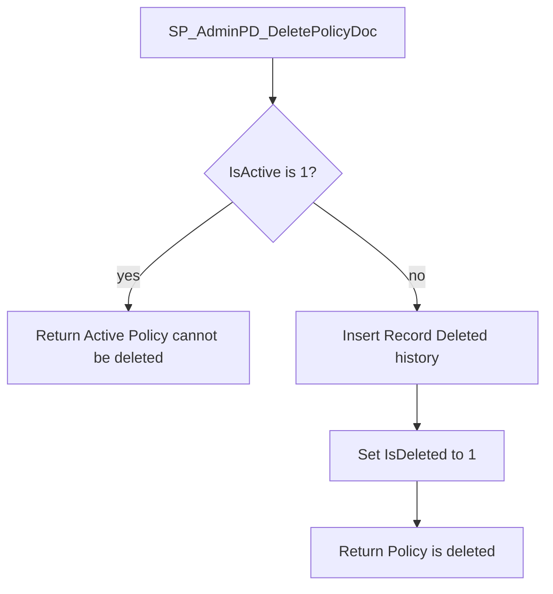

# SP_AdminPD_DeletePolicyDoc

## What it does

Refuses to delete a policy that is still active. For an inactive policy it copies the row into history and sets `IsDeleted` to 1. The row stays in `TPolicyDocument`. The header comment has no description. The modification note cites the sign-off and exclusion work item.

`PolicyDocDAL.DeletePolicyDocument` calls this from Policy Documents Setup and shows `ErrorMessage` from the first row.

## Parameters

| Name | Direction | What it is for |
|---|---|---|
| `@DocumentId` | in | Policy to delete. |
| `@Employerid` | in | Employer filter on the history insert and the update. The active check does not use it. |
| `@ModifiedBy` | in | Stored as `ModifiedBy` on the live row and as `HistoryCreatedBy` on the history row. |

## Call sequence

Calls no other procedures or functions.

## Callers

No other procedure or function calls this object. `PolicyDocDAL.DeletePolicyDocument` executes it from Policy Documents Setup.

## Nested

Calls no other procedures or functions.

## Steps

1. In `HRMS-DATABASE/HRMS/STOREPROCEDURE/SP_AdminPD_DeletePolicyDoc.sql`, look for one `tPolicyDocument` row with `@DocumentId` and `IsActive` 1. This check does not filter `@Employerid`.
2. When that row exists, return `ErrorId` 1 and `ErrorMessage` `Active Policy cannot be deleted`, then `RETURN`.
3. Otherwise insert the current `TPolicyDocument` row into `TPolicyDocument_History` with `Action` `Record Deleted`, `StorageId` null, and `HistoryCreatedBy` `@ModifiedBy`. The column list includes the exclusion ids and `EnforcementMode`. It does not include `AcknStatement` or `IsDeleted`. The insert is filtered by `@DocumentId` and `@Employerid`.
4. Set `IsDeleted` to 1, `ModifiedBy` to `@ModifiedBy`, and `ModifiedDate` to `GETDATE()` on that same document and employer.
5. Return `ErrorId` 0 and `ErrorMessage` `Policy is deleted`.

The `ELSE` has no `BEGIN`/`END`. The history insert is the statement attached to `ELSE`. The update and the success select sit after that `IF`/`ELSE`. They do not run for an active policy because step 2 returns.

## Tables

| Table | Read or write |
|---|---|
| `dbo.TPolicyDocument` | read, write |
| `dbo.TPolicyDocument_History` | write |

## Flow

