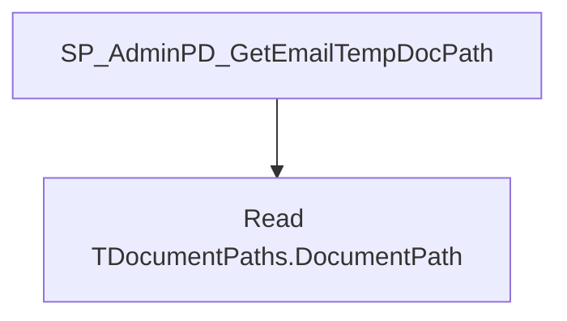

# SP_AdminPD_GetEmailTempDocPath

## What it does

Returns the stored folder path for one document type. Policy Documents Setup calls it with `PolicyDocuments` and joins that folder to the customer number before it saves the PDF. The script has no header comment.

`PolicyDocDAL.GetTemplateDocumentPath` calls this.

## Parameters

| Name | Direction | What it is for |
|---|---|---|
| `@DocumentType` | in | Document type to look up, `varchar(100)`. |

## Call sequence

Calls no other procedures or functions.

## Callers

No other procedure or function calls this object. `PolicyDocDAL.GetTemplateDocumentPath` executes it from Policy Documents Setup.

## Nested

Calls no other procedures or functions.

## Steps

1. In `HRMS-DATABASE/HRMS/STOREPROCEDURE/SP_AdminPD_GetEmailTempDocPath.sql`, select `DocumentPath` from `TDocumentPaths` where `DocumentType` equals `@DocumentType`.
2. There is no `isDeleted` filter and no `TOP`. Every matching row is returned. The DAL reads the first row's `DocumentPath`.

## Tables

| Table | Read or write |
|---|---|
| `dbo.TDocumentPaths` | read |

## Flow

