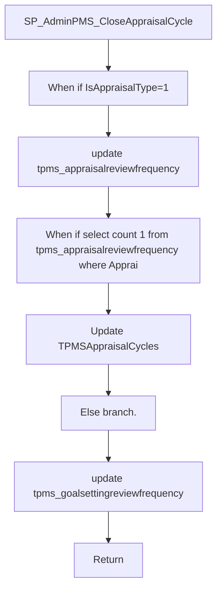

# SP_AdminPMS_CloseAppraisalCycle

## What it does

Stored procedure `SP_AdminPMS_CloseAppraisalCycle`. Writes `tpms_appraisalreviewfrequency`, `TPMSAppraisalCycles`, `tpms_goalsettingreviewfrequency`, `TPMSEmployeeGoalSetting`. Calls no other procedure or function.

## Parameters

| Name | Direction | What it is for |
|---|---|---|
| `@CycleId` | in | Int |
| `@Employeeid` | in | Int |
| `@IsAppraisalType` | in | bit, default 1 |
| `@ReviewFrequncyId` | in | int, default 0 |

## Call sequence

Calls no other procedures or functions.

## Callers

No other procedure or function calls this object.

## Nested

Calls no other procedures or functions.

## Steps

1. Script is `HRMS-DATABASE/HRMS/STOREPROCEDURE/SP_AdminPMS_CloseAppraisalCycle.sql`.
2. When if(@IsAppraisalType=1)
3. update tpms_appraisalreviewfrequency
4. When if((select count(1) from tpms_appraisalreviewfrequency where AppraisalCycleId=@CycleId and status in ('Initiated','Pending'))=0)
5. Update TPMSAppraisalCycles
6. Else branch.
7. update tpms_goalsettingreviewfrequency
8. When if((select count(1) from tpms_goalsettingreviewfrequency where goalsettingid=@CycleId and status in ('Initiated','Pending'))=0)
9. Update TPMSEmployeeGoalSetting

## Tables

| Table | Read or write |
|---|---|
| `TPMSAppraisalCycles` | write |
| `TPMSEmployeeGoalSetting` | write |
| `tpms_appraisalreviewfrequency` | read and write |
| `tpms_goalsettingreviewfrequency` | read and write |

## Flow

