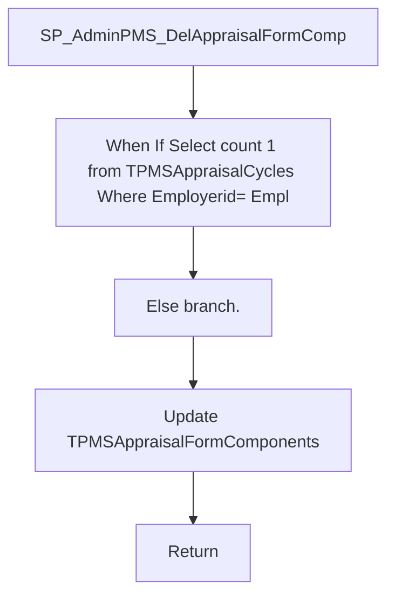

# SP_AdminPMS_DelAppraisalFormComp

## What it does

Stored procedure `SP_AdminPMS_DelAppraisalFormComp`. Writes `TPMSAppraisalFormComponents`. Reads `TPMSAppraisalCycles`. Calls no other procedure or function.

## Parameters

| Name | Direction | What it is for |
|---|---|---|
| `@ApprisalCycleId` | in | Int |
| `@Transid` | in | Int |
| `@Employerid` | in | Int |
| `@ModifiedBy` | in | Int |

## Call sequence

Calls no other procedures or functions.

## Callers

No other procedure or function calls this object.

## Nested

Calls no other procedures or functions.

## Steps

1. Script is `HRMS-DATABASE/HRMS/STOREPROCEDURE/SP_AdminPMS_DelAppraisalFormComp.sql`.
2. When If (Select count(1) from TPMSAppraisalCycles Where Employerid=@Employerid And AppraisalCycleId=@ApprisalCycleId And IsInitiated=1)>0
3. Else branch.
4. Update TPMSAppraisalFormComponents

## Tables

| Table | Read or write |
|---|---|
| `TPMSAppraisalCycles` | read |
| `TPMSAppraisalFormComponents` | write |

## Flow

