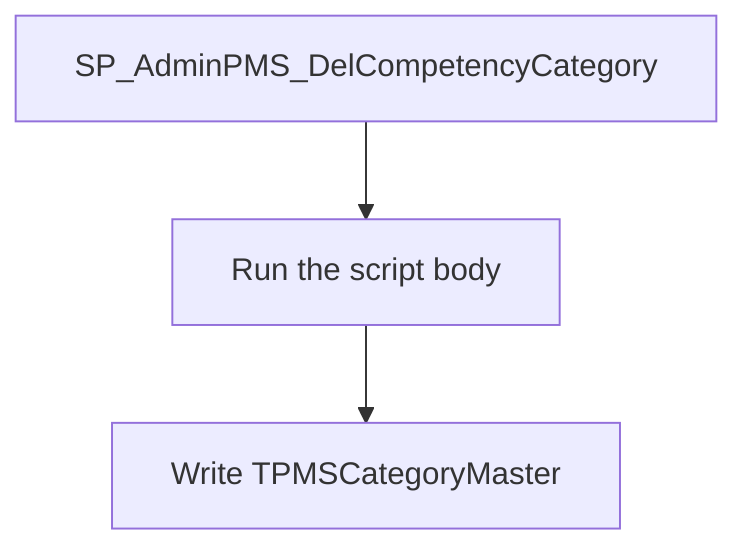

# SP_AdminPMS_DelCompetencyCategory

## What it does

Deletes a form definition when goal settings and appraisal mappings do not still use that category.

## Parameters

| Name | Direction | What it is for |
|---|---|---|
| `@CategoryId` | in | Category Id |
| `@Employerid` | in | Employerid |
| `@ModifiedBy` | in | Modified By |

## Call sequence

Calls no other procedures or functions.

## Callers

No other procedure or function calls this object.

## Nested

Calls no other procedures or functions.

## Steps

Script: `HRMS-DATABASE/HRMS/STOREPROCEDURE/SP_AdminPMS_DelCompetencyCategory.sql`.

1. if((select Count(1) from TPMSCategoryMaster where CategoryId=@CategoryId and AppraisalType in ('P','T'))>0)
2. If (select count(1) from TPMSEmployeeGoalsetting gs,TPMSEmployeeGoalSettingTemplate st
3. Select 0 ErrorCode
4. Update TPMSCategoryMaster
5. Select 1 ErrorCode
6. If (Select Count(1) From TPMSEmployeeAppraisalCycleMapping Where Employerid=@Employerid And Categoryid=@CategoryId)>0
7. Select 0 ErrorCode
8. Update TPMSCategoryMaster
9. Select 1 ErrorCode

## Tables

| Table | Read or write |
|---|---|
| `TPMSCategoryMaster` | read/write |
| `TPMSEmployeeGoalsetting` | read |
| `TPMSEmployeeAppraisalCycleMapping` | read |

## Flow

