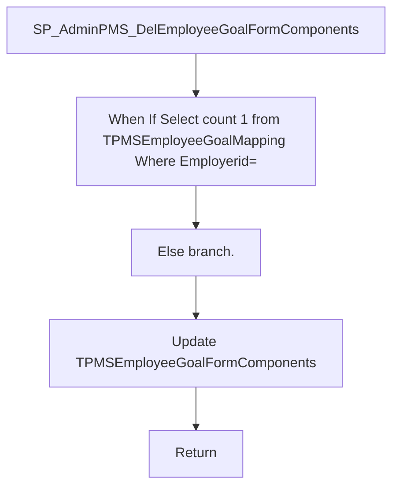

# SP_AdminPMS_DelEmployeeGoalFormComponents

## What it does

Stored procedure `SP_AdminPMS_DelEmployeeGoalFormComponents`. Writes `TPMSEmployeeGoalFormComponents`. Reads `TPMSEmployeeGoalMapping`. Calls no other procedure or function.

## Parameters

| Name | Direction | What it is for |
|---|---|---|
| `@GoalSettingId` | in | Int |
| `@Transid` | in | Int |
| `@Employerid` | in | Int |
| `@ModifiedBy` | in | Int |

## Call sequence

Calls no other procedures or functions.

## Callers

No other procedure or function calls this object.

## Nested

Calls no other procedures or functions.

## Steps

1. Script is `HRMS-DATABASE/HRMS/STOREPROCEDURE/SP_AdminPMS_DelEmployeeGoalFormComponents.sql`.
2. When If (Select count(1) from TPMSEmployeeGoalMapping Where Employerid=@Employerid And GoalSettingId=@GoalSettingId And IsInitiated=1)>0
3. Else branch.
4. Update TPMSEmployeeGoalFormComponents

## Tables

| Table | Read or write |
|---|---|
| `TPMSEmployeeGoalFormComponents` | write |
| `TPMSEmployeeGoalMapping` | read |

## Flow

