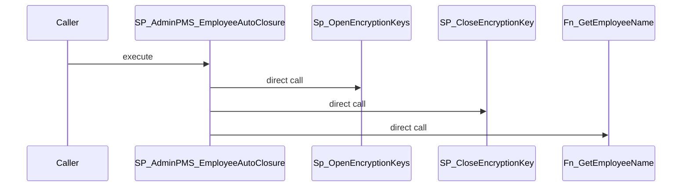
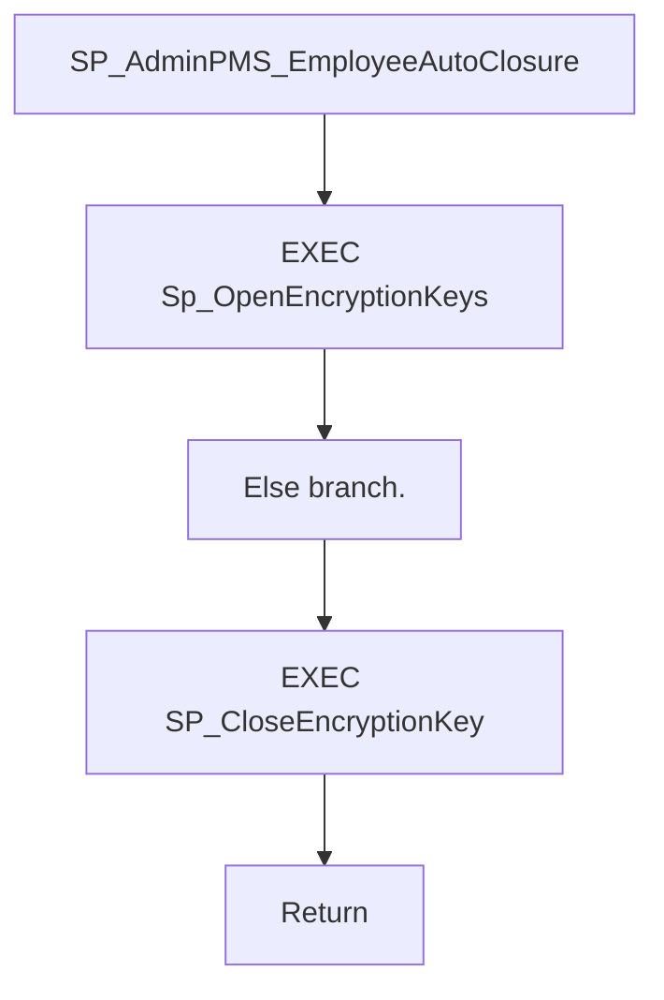

# SP_AdminPMS_EmployeeAutoClosure

## What it does

Stored procedure `SP_AdminPMS_EmployeeAutoClosure`. Reads `TResignationDetails`, `TPMS_EmployeeAutoCloseRequest`, `tEmployeeinfo`, `TEmployee`, `TPMSEmployerConfiguration`, `TPMSConfigureAutoClosureRequestData`, `TPMSAppraisalCycles`, `TPMS_AppraisalReviewFrequency`. Calls `Sp_OpenEncryptionKeys`, `SP_CloseEncryptionKey`, `Fn_GetEmployeeName`.

## Parameters

| Name | Direction | What it is for |
|---|---|---|
| `@EmployerId` | in | INT |
| `@AppraisalCycleId` | in | int, default 911 |
| `@ReviewFrequencyId` | in | int, default 1811 |

## Call sequence

## Callers

No other procedure or function calls this object.

## Nested

| Object | Kind | When | Page |
|---|---|---|---|
| `Sp_OpenEncryptionKeys` | procedure | direct call | [Sp_OpenEncryptionKeys](/docs/database/hrms/Sp_OpenEncryptionKeys) |
| `SP_CloseEncryptionKey` | procedure | direct call | [SP_CloseEncryptionKey](/docs/database/hrms/SP_CloseEncryptionKey) |
| `Fn_GetEmployeeName` | function | direct call | [Fn_GetEmployeeName](/docs/database/hrms/Fn_GetEmployeeName) |

## Steps

1. Script is `HRMS-DATABASE/HRMS/STOREPROCEDURE/SP_AdminPMS_EmployeeAutoClosure.sql`.
2. EXEC Sp_OpenEncryptionKeys
3. Else branch.
4. EXEC SP_CloseEncryptionKey

## Tables

| Table | Read or write |
|---|---|
| `TEmployee` | read |
| `TPMSAppraisalCycles` | read |
| `TPMSConfigureAutoClosureRequestData` | read |
| `TPMSEmployerConfiguration` | read |
| `TPMS_AppraisalReviewFrequency` | read |
| `TPMS_EmployeeAutoCloseRequest` | read |
| `TResignationDetails` | read |
| `tEmployeeinfo` | read |

## Flow

