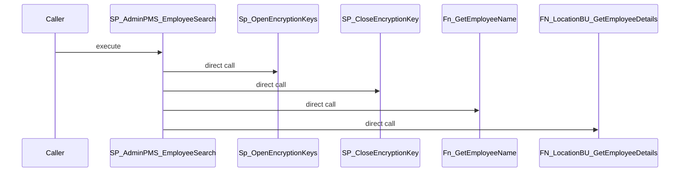
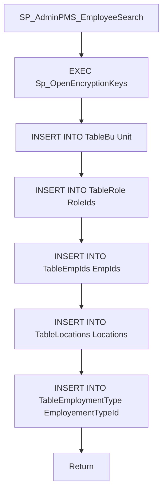

# SP_AdminPMS_EmployeeSearch

## What it does

Stored procedure `SP_AdminPMS_EmployeeSearch`. Reads `TPMSEmployerConfiguration`, `TPMSAppraisalCycles`, `TPMS_AppraisalReviewFrequency`, `TTitle`, `TMEmploymentTypes`, `TPMSEmployeeAppraisalCycleMapping`, `TLocation`, `TEmployeeRoleMaster`, and others. Calls `Sp_OpenEncryptionKeys`, `SP_CloseEncryptionKey`, `Fn_GetEmployeeName`, `FN_LocationBU_GetEmployeeDetails`.

## Parameters

| Name | Direction | What it is for |
|---|---|---|
| `@EmployerId` | in | INT |
| `@EmployeeIds` | in | NVARCHAR(4000), default '' |
| `@EmployementTypeId` | in | NVARCHAR(2000), default NULL |
| `@DesignationId` | in | NVARCHAR(2000), default NULL |
| `@BusinessUnit` | in | NVARCHAR(2000), default NULL |
| `@LocationId` | in | NVARCHAR(2000), default NULL |
| `@RoleIds` | in | NVARCHAR(2000), default NULL |
| `@EmployeeId` | in | INT, default 0 |
| `@ExcludeActiveResigned` | in | bit, default 0 |
| `@AppraisalCycleId` | in | int, default 0 |
| `@ExcludeEligibilityRules` | in | bit, default 0 |

## Call sequence

## Callers

No other procedure or function calls this object.

## Nested

| Object | Kind | When | Page |
|---|---|---|---|
| `Sp_OpenEncryptionKeys` | procedure | direct call | [Sp_OpenEncryptionKeys](/docs/database/hrms/Sp_OpenEncryptionKeys) |
| `SP_CloseEncryptionKey` | procedure | direct call | [SP_CloseEncryptionKey](/docs/database/hrms/SP_CloseEncryptionKey) |
| `Fn_GetEmployeeName` | function | direct call | [Fn_GetEmployeeName](/docs/database/hrms/Fn_GetEmployeeName) |
| `FN_LocationBU_GetEmployeeDetails` | function | direct call | [FN_LocationBU_GetEmployeeDetails](/docs/database/hrms/FN_LocationBU_GetEmployeeDetails) |

## Steps

1. Script is `HRMS-DATABASE/HRMS/STOREPROCEDURE/SP_AdminPMS_EmployeeSearch.sql`.
2. EXEC Sp_OpenEncryptionKeys
3. INSERT INTO @TableBu (Unit)
4. INSERT INTO @TableRole (RoleIds)
5. INSERT INTO @TableEmpIds (EmpIds)
6. INSERT INTO @TableLocations (Locations)
7. INSERT INTO @TableEmploymentType (EmployementTypeId)
8. INSERT INTO @TableDesignationId (DesignationId)
9. When IF (
10. Else branch.
11. EXEC SP_CloseEncryptionKey

## Tables

| Table | Read or write |
|---|---|
| `TEmployee` | read |
| `TEmployeeInfo` | read |
| `TEmployeeRoleMaster` | read |
| `TLocation` | read |
| `TMEmploymentTypes` | read |
| `TORGChart` | read |
| `TPMSAppraisalCycles` | read |
| `TPMSEmployeeAppraisalCycleMapping` | read |
| `TPMSEmployerConfiguration` | read |
| `TPMS_AppraisalReviewFrequency` | read |
| `TRequestWorkflows` | read |
| `TSeparationType` | read |
| `TTitle` | read |
| `tResignationDetails` | read |

## Flow

