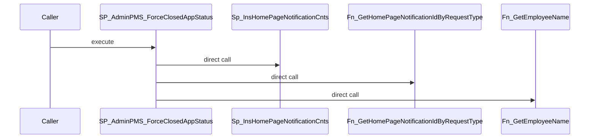
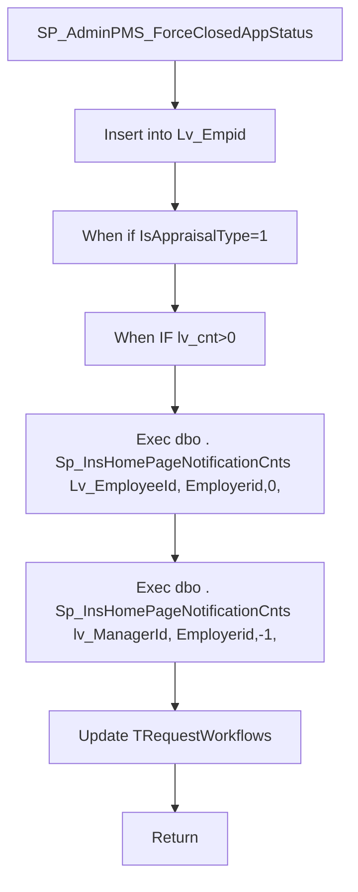

# SP_AdminPMS_ForceClosedAppStatus

## What it does

Stored procedure `SP_AdminPMS_ForceClosedAppStatus`. Writes `TRequestWorkflows`, `TPMSEmployeeSelfAppraisal`, `TPMSEMPLOYEEGOALMAPPING`. Reads `Temployee`. Calls `Sp_InsHomePageNotificationCnts`, `Fn_GetHomePageNotificationIdByRequestType`, `Fn_GetEmployeeName`.

## Parameters

| Name | Direction | What it is for |
|---|---|---|
| `@Employeeid` | in | Varchar(Max) |
| `@CycleId` | in | Int |
| `@Comments` | in | Varchar(100) |
| `@UpdatedBy` | in | Int |
| `@IsAppraisalType` | in | bit, default 1 |
| `@ReviewFrequncyId` | in | int, default 0 |

## Call sequence

## Callers

No other procedure or function calls this object.

## Nested

| Object | Kind | When | Page |
|---|---|---|---|
| `Sp_InsHomePageNotificationCnts` | procedure | direct call | [Sp_InsHomePageNotificationCnts](/docs/database/hrms/Sp_InsHomePageNotificationCnts) |
| `Fn_GetHomePageNotificationIdByRequestType` | function | direct call | [Fn_GetHomePageNotificationIdByRequestType](/docs/database/hrms/Fn_GetHomePageNotificationIdByRequestType) |
| `Fn_GetEmployeeName` | function | direct call | [Fn_GetEmployeeName](/docs/database/hrms/Fn_GetEmployeeName) |

## Steps

1. Script is `HRMS-DATABASE/HRMS/STOREPROCEDURE/SP_AdminPMS_ForceClosedAppStatus.sql`.
2. Insert into @Lv_Empid
3. When if(@IsAppraisalType=1)
4. When IF @lv_cnt>0
5. Exec [dbo].[Sp_InsHomePageNotificationCnts] @Lv_EmployeeId,@Employerid,0,-1,@Lv_HomePagaNotificationId,'SelfAssessment',@lv_Transid,'SP_ForceClosedAppraisalStatus'
6. Exec [dbo].[Sp_InsHomePageNotificationCnts] @lv_ManagerId,@Employerid,-1,0,@Lv_HomePagaNotificationId,'SelfAssessment',@lv_Transid,'SP_ForceClosedAppraisalStatus','Pending in Manag
7. Update TRequestWorkflows
8. Update TPMSEmployeeSelfAppraisal
9. Else branch.
10. Update TPMSEMPLOYEEGOALMAPPING

## Tables

| Table | Read or write |
|---|---|
| `TPMSEMPLOYEEGOALMAPPING` | write |
| `TPMSEmployeeSelfAppraisal` | read and write |
| `TRequestWorkflows` | read and write |
| `Temployee` | read |

## Flow

