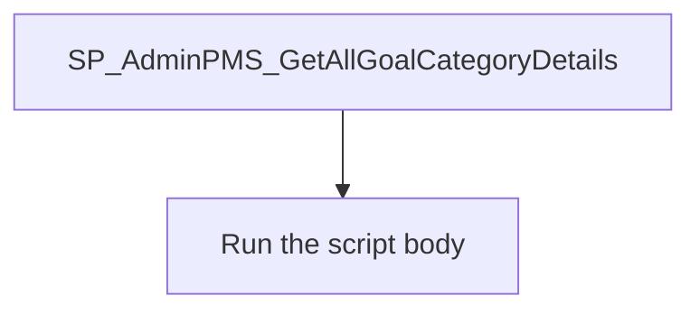

# SP_AdminPMS_GetAllGoalCategoryDetails

## What it does

Lists KRA and goal dictionary rows for an employer, with their category.

## Parameters

| Name | Direction | What it is for |
|---|---|---|
| `@Employerid` | in | Employerid |

## Call sequence

Calls no other procedures or functions.

## Callers

No other procedure or function calls this object.

## Nested

Calls no other procedures or functions.

## Steps

Script: `HRMS-DATABASE/HRMS/STOREPROCEDURE/SP_AdminPMS_GetAllGoalCategoryDetails.sql`.

1. Join `TPMSGoalCategory` to `TPMSGoalCategoryDetails` and return category and dictionary columns, including goal name and description.
2. Keep rows where both the category and the detail have `IsDeleted` 0 and the category `Employerid` is `@Employerid`.
3. Order by `Categoryid` descending.

## Tables

| Table | Read or write |
|---|---|
| `TPMSGOALCATEGORY` | read |
| `TPMSGOALCATEGORYDETAILS` | read |

## Flow

