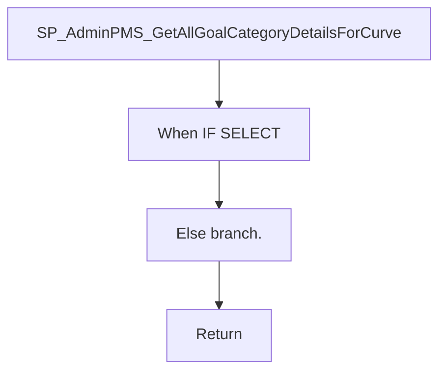

# SP_AdminPMS_GetAllGoalCategoryDetailsForCurve

## What it does

Stored procedure `SP_AdminPMS_GetAllGoalCategoryDetailsForCurve`. Reads `TPMSGoalCategoryOutcomeDeatils`, `TPMSGoalCategoryDetails`. Calls no other procedure or function.

## Parameters

| Name | Direction | What it is for |
|---|---|---|
| `@CategoryId` | in | Int |

## Call sequence

Calls no other procedures or functions.

## Callers

No other procedure or function calls this object.

## Nested

Calls no other procedures or functions.

## Steps

1. Script is `HRMS-DATABASE/HRMS/STOREPROCEDURE/SP_AdminPMS_GetAllGoalCategoryDetailsForCurve.sql`.
2. When IF ((SELECT
3. Else branch.

## Tables

| Table | Read or write |
|---|---|
| `TPMSGoalCategoryDetails` | read |
| `TPMSGoalCategoryOutcomeDeatils` | read |

## Flow

