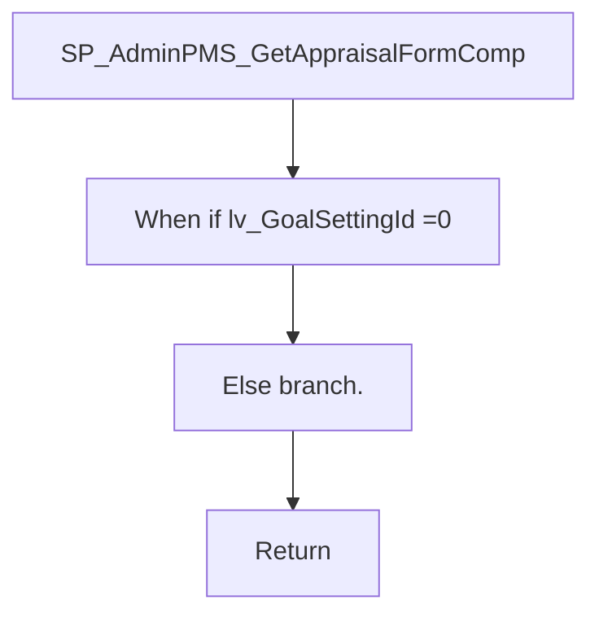

# SP_AdminPMS_GetAppraisalFormComp

## What it does

Stored procedure `SP_AdminPMS_GetAppraisalFormComp`. Reads `tpmsappraisalcycles`, `TPMS_AppraisalReviewFrequency`, `TPMS_AssessmentComponentPermissions`, `TPMS_ViewAssessmentComponentPermissions`, `TPMSAppraisalFormComponents`, `TPMS_AssesmentGoalReviewFrequencies`, `TPMSAppraisalCycles`, `TPMSEmployeeGoalMapping`, and others. Calls no other procedure or function.

## Parameters

| Name | Direction | What it is for |
|---|---|---|
| `@ApprisalCycleId` | in | Int |
| `@Employerid` | in | Int |

## Call sequence

Calls no other procedures or functions.

## Callers

No other procedure or function calls this object.

## Nested

Calls no other procedures or functions.

## Steps

1. Script is `HRMS-DATABASE/HRMS/STOREPROCEDURE/SP_AdminPMS_GetAppraisalFormComp.sql`.
2. When if(@lv_GoalSettingId =0)
3. Else branch.

## Tables

| Table | Read or write |
|---|---|
| `TPMSAppraisalCycles` | read |
| `TPMSAppraisalFormComponents` | read |
| `TPMSEmployeeGoalFormComponents` | read |
| `TPMSEmployeeGoalMapping` | read |
| `TPMS_AppraisalReviewFrequency` | read |
| `TPMS_AssesmentGoalReviewFrequencies` | read |
| `TPMS_AssessmentComponentPermissions` | read |
| `TPMS_GoalComponentPermissions` | read |
| `TPMS_ViewAssessmentComponentPermissions` | read |
| `TPMS_ViewGoalComponentPermissions` | read |
| `tpmsappraisalcycles` | read |

## Flow

