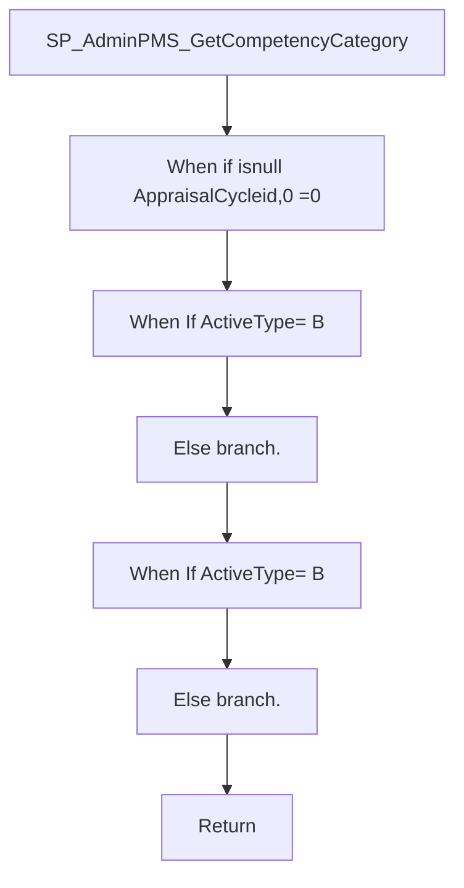

# SP_AdminPMS_GetCompetencyCategory

## What it does

Stored procedure `SP_AdminPMS_GetCompetencyCategory`. Reads `tpmscategorymaster`, `TPMSCategoryDesignationMapping`, `TPMSAppraisalCycles`. Calls no other procedure or function.

## Parameters

| Name | Direction | What it is for |
|---|---|---|
| `@Employerid` | in | Int |
| `@ActiveType` | in | Char(1) |
| `@AppraisalCycleid` | in | INT, default null |
| `@FormType` | in | Char(1), default 'P' |

## Call sequence

Calls no other procedures or functions.

## Callers

No other procedure or function calls this object.

## Nested

Calls no other procedures or functions.

## Steps

1. Script is `HRMS-DATABASE/HRMS/STOREPROCEDURE/SP_AdminPMS_GetCompetencyCategory.sql`.
2. When if(isnull(@AppraisalCycleid,0) =0)
3. When If @ActiveType='B'
4. Else branch.
5. When If @ActiveType='B'
6. Else branch.

## Tables

| Table | Read or write |
|---|---|
| `TPMSAppraisalCycles` | read |
| `TPMSCategoryDesignationMapping` | read |
| `tpmscategorymaster` | read |

## Flow

