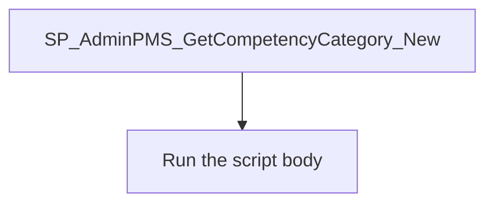

# SP_AdminPMS_GetCompetencyCategory_New

## What it does

Lists form definitions for an employer. `@ActiveType` chooses active, inactive, or both.

## Parameters

| Name | Direction | What it is for |
|---|---|---|
| `@Employerid` | in | Employerid |
| `@ActiveType` | in | Active Type |

## Call sequence

Calls no other procedures or functions.

## Callers

No other procedure or function calls this object.

## Nested

Calls no other procedures or functions.

## Steps

Script: `HRMS-DATABASE/HRMS/STOREPROCEDURE/SP_AdminPMS_GetCompetencyCategory_New.sql`.

1. If @ActiveType='B'
2. Select cm.Categoryid,
3. else 'Cumulative' end as FormWeightageCalculation
4. Else If @ActiveType='A'
5. Select cm.Categoryid,
6. else 'Cumulative' end as FormWeightageCalculation

## Tables

| Table | Read or write |
|---|---|
| `tpmscategorymaster` | read |

## Flow

