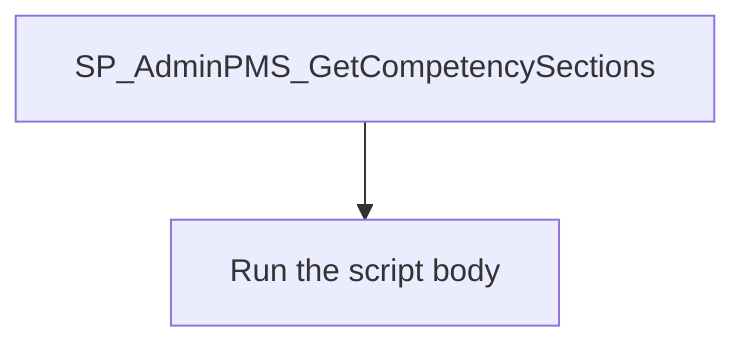

# SP_AdminPMS_GetCompetencySections

## What it does

Returns one form's sections, competency and KRA weights, and goal-form layout so the designer or preview can redraw it.

## Parameters

| Name | Direction | What it is for |
|---|---|---|
| `@Categoryid` | in | Categoryid |

## Call sequence

Calls no other procedures or functions.

## Callers

| Object | Kind | Page |
|---|---|---|
| `Sp_AdminPMS_GetEmployeeAssessmentProspective` | procedure | No page yet |

## Nested

Calls no other procedures or functions.

## Steps

Script: `HRMS-DATABASE/HRMS/STOREPROCEDURE/SP_AdminPMS_GetCompetencySections.sql`.

1. SELECT * FROM (
2. SELECT cm.Categoryid
3. ELSE 0
4. Select * FROM TPMSCategoryMasterGoalFormData gf WHERE gf.CategoryId = @Categoryid

## Tables

| Table | Read or write |
|---|---|
| `tpmscategorymaster` | read |
| `TPMSEmployerConfiguration` | read |
| `TPMSEmployeeGoalFormSettingDetails` | read |
| `TPMSCategorySections` | read |
| `TPMS_TEmployeeGoalSections` | read |
| `TPMSCategoryMasterGoalFormData` | read |

## Flow

