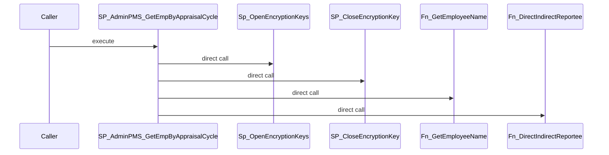
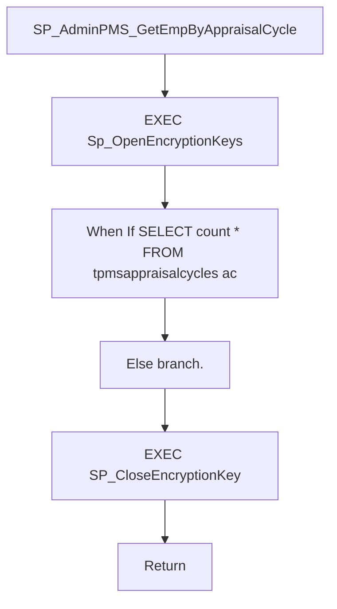

# SP_AdminPMS_GetEmpByAppraisalCycle

## What it does

Stored procedure `SP_AdminPMS_GetEmpByAppraisalCycle`. Reads `tpmsappraisalcycles`, `TTitle`, `TOrgHierarchyDetails`, `TMEmploymentTypes`, `TPMSEmployeeSelfAppraisal`, `TRequestWorkflows`, `TORGChart`, `TUsers`, and others. Calls `Sp_OpenEncryptionKeys`, `SP_CloseEncryptionKey`, `Fn_GetEmployeeName`, `Fn_DirectIndirectReportee`.

## Parameters

| Name | Direction | What it is for |
|---|---|---|
| `@AppraisalCycleId` | in | Int |
| `@Employerid` | in | Int |
| `@Employeeid` | in | Int, default 0 |

## Call sequence

## Callers

No other procedure or function calls this object.

## Nested

| Object | Kind | When | Page |
|---|---|---|---|
| `Sp_OpenEncryptionKeys` | procedure | direct call | [Sp_OpenEncryptionKeys](/docs/database/hrms/Sp_OpenEncryptionKeys) |
| `SP_CloseEncryptionKey` | procedure | direct call | [SP_CloseEncryptionKey](/docs/database/hrms/SP_CloseEncryptionKey) |
| `Fn_GetEmployeeName` | function | direct call | [Fn_GetEmployeeName](/docs/database/hrms/Fn_GetEmployeeName) |
| `Fn_DirectIndirectReportee` | function | direct call | [Fn_DirectIndirectReportee](/docs/database/hrms/Fn_DirectIndirectReportee) |

## Steps

1. Script is `HRMS-DATABASE/HRMS/STOREPROCEDURE/SP_AdminPMS_GetEmpByAppraisalCycle.sql`.
2. EXEC Sp_OpenEncryptionKeys
3. When If((SELECT count(*) FROM tpmsappraisalcycles ac
4. Else branch.
5. EXEC SP_CloseEncryptionKey

## Tables

| Table | Read or write |
|---|---|
| `TEmployee` | read |
| `TEmployeeOrgBusinessHead` | read |
| `TEmployeeinfo` | read |
| `TMEmploymentTypes` | read |
| `TORGChart` | read |
| `TOrgHierarchyDetails` | read |
| `TPMSAppraisalCycles` | read |
| `TPMSAssessmentViewManagerPermissions` | read |
| `TPMSEmployeeAppraisalCycleMapping` | read |
| `TPMSEmployeeCompetencyRatings` | read |
| `TPMSEmployeeSelfAppraisal` | read |
| `TPMS_AssesmentGoalReviewFrequencies` | read |
| `TRequestWorkflows` | read |
| `TRoles` | read |
| `TTitle` | read |
| `TUserEmployee` | read |
| `TUsers` | read |
| `Temployee` | read |
| `tpms_appraisalreviewsequence` | read |
| `tpmsappraisalcycles` | read |
| `tpmsemployeegoalmapping` | read |

## Flow

