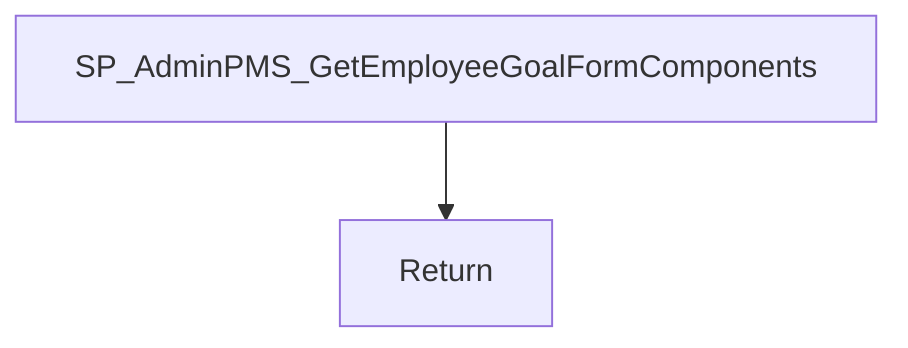

# SP_AdminPMS_GetEmployeeGoalFormComponents

## What it does

Stored procedure `SP_AdminPMS_GetEmployeeGoalFormComponents`. Reads `TPMS_GoalComponentPermissions`, `TPMSEmployeeGoalMapping`, `TPMS_ViewGoalComponentPermissions`, `TPMSEmployeeGoalFormComponents`. Calls no other procedure or function.

## Parameters

| Name | Direction | What it is for |
|---|---|---|
| `@GoalSettingId` | in | Int |
| `@Employerid` | in | Int |

## Call sequence

Calls no other procedures or functions.

## Callers

No other procedure or function calls this object.

## Nested

Calls no other procedures or functions.

## Steps

1. Script is `HRMS-DATABASE/HRMS/STOREPROCEDURE/SP_AdminPMS_GetEmployeeGoalFormComponents.sql`.

## Tables

| Table | Read or write |
|---|---|
| `TPMSEmployeeGoalFormComponents` | read |
| `TPMSEmployeeGoalMapping` | read |
| `TPMS_GoalComponentPermissions` | read |
| `TPMS_ViewGoalComponentPermissions` | read |

## Flow

