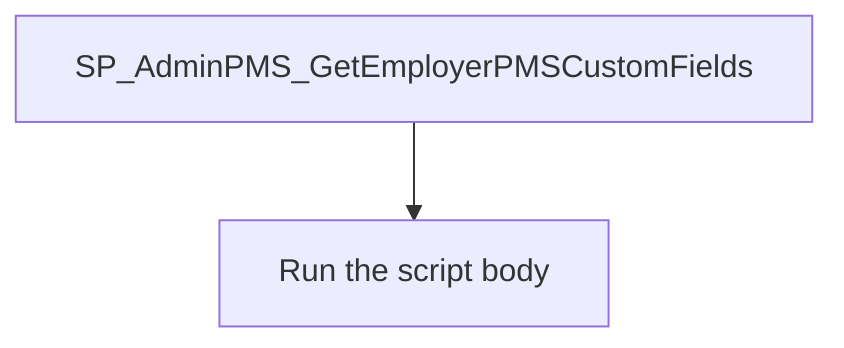

# SP_AdminPMS_GetEmployerPMSCustomFields

## What it does

Returns the custom competency and KRA labels saved for an employer.

## Parameters

| Name | Direction | What it is for |
|---|---|---|
| `@Employerid` | in | Employerid |

## Call sequence

Calls no other procedures or functions.

## Callers

No other procedure or function calls this object.

## Nested

Calls no other procedures or functions.

## Steps

Script: `HRMS-DATABASE/HRMS/STOREPROCEDURE/SP_AdminPMS_GetEmployerPMSCustomFields.sql`.

1. Select the custom-label columns from `TEmployerPMSCustomFields` where `Employerid` is `@Employerid`.

## Tables

| Table | Read or write |
|---|---|
| `TEmployerPMSCustomFields` | read |

## Flow

