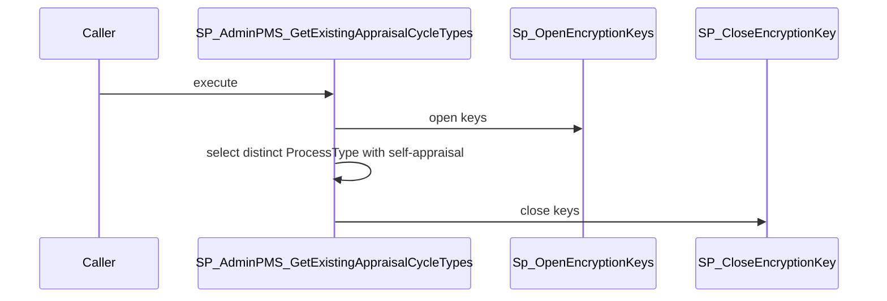
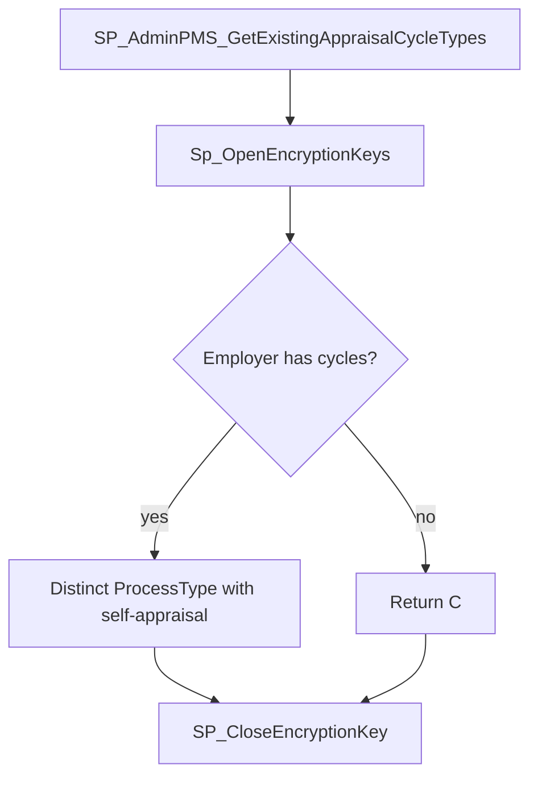

# SP_AdminPMS_GetExistingAppraisalCycleTypes

## What it does

Returns distinct appraisal `ProcessType` codes (`C`, `K`, `G`, `B`, `T`) that already exist for an employer and have at least one `TPMSEmployeeSelfAppraisal` row. Opens encryption keys for the session even though the result set does not decrypt employee fields. When the employer has no cycles at all, returns a single default row `C`.

## Parameters

| Name | Direction | What it is for |
|---|---|---|
| `@EmployerId` | in | Employer whose non-deleted cycles are scanned (default 0) |

## Call sequence

## Callers

No other procedure or function calls this object. `performanceAssessmentDAL.GetExistingAppraisalCycleTypes` executes it for Normalization appraisal-type radios.

## Nested

| Object | Kind | When | Page |
|---|---|---|---|
| `Sp_OpenEncryptionKeys` | procedure | start | [Sp_OpenEncryptionKeys](/docs/database/hrms/Sp_OpenEncryptionKeys) |
| `SP_CloseEncryptionKey` | procedure | end | [SP_CloseEncryptionKey](/docs/database/hrms/SP_CloseEncryptionKey) |

## Steps

1. Script is `HRMS-DATABASE/HRMS/STOREPROCEDURE/SP_AdminPMS_GetExistingAppraisalCycleTypes.sql`.
2. `EXEC Sp_OpenEncryptionKeys`.
3. If the employer has any `TPMSAppraisalCycles` rows, build a CTE of ordered process types and return those present on non-deleted cycles that have self-appraisal rows.
4. Else return `'C'` with `AppraisalTypeCount` 1.
5. `EXEC SP_CloseEncryptionKey`.

## Tables

| Table | Read or write |
|---|---|
| `TPMSAppraisalCycles` | read |
| `TPMSEmployeeSelfAppraisal` | read |

## Unresolved calls

None.

## Flow

