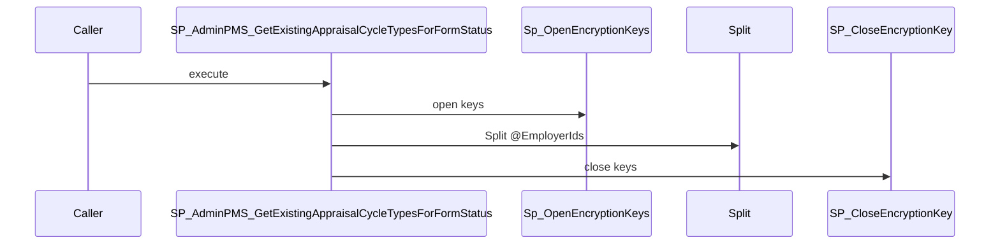
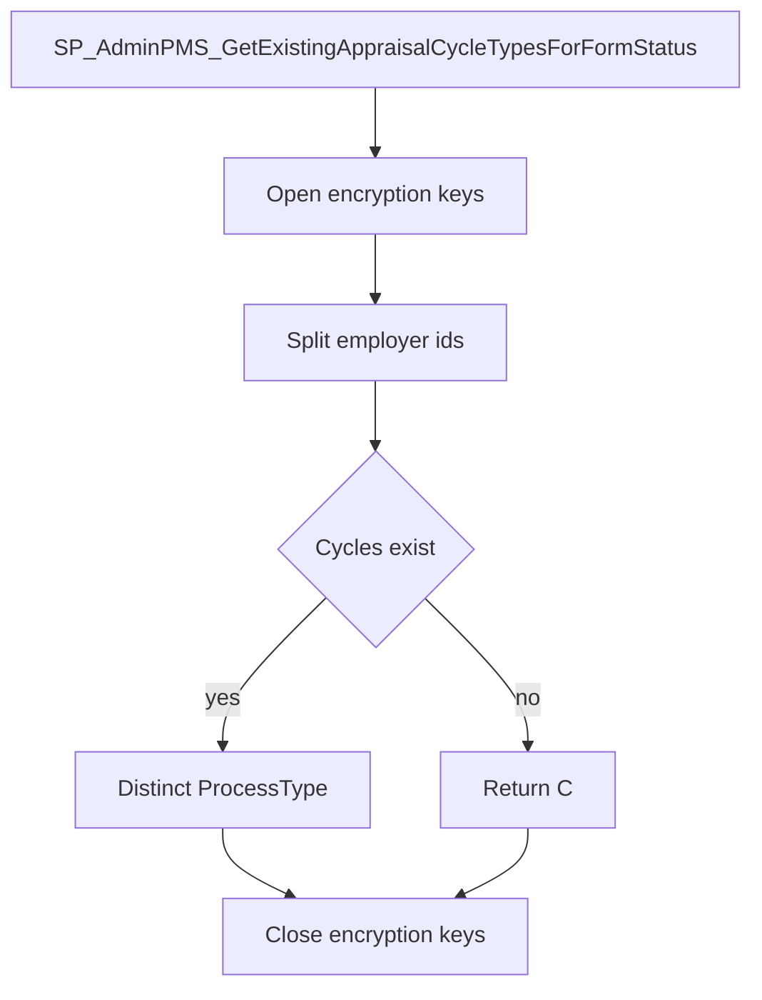

# SP_AdminPMS_GetExistingAppraisalCycleTypesForFormStatus

## What it does

Returns the appraisal process types (`C`, `K`, `G`, `B`, `T`) that exist on non-deleted cycles for the employer list. When the employers have no cycles, returns a single default `C` row. Used by Assessment Status for appraisal-type radios.

## Parameters

| Name | Direction | What it is for |
|---|---|---|
| `@EmployerIds` | in | Comma-separated employer ids (default `'0'`) |

## Call sequence

## Callers

No other procedure or function calls this object.

## Nested

| Object | Kind | When | Page |
|---|---|---|---|
| `Sp_OpenEncryptionKeys` | procedure | start of body | [Sp_OpenEncryptionKeys](/docs/database/hrms/Sp_OpenEncryptionKeys) |
| `Split` | function | split employer ids | [Split](/docs/database/hrms/Split) |
| `SP_CloseEncryptionKey` | procedure | end of body | [SP_CloseEncryptionKey](/docs/database/hrms/SP_CloseEncryptionKey) |

## Steps

Script: `HRMS-DATABASE/HRMS/STOREPROCEDURE/SP_AdminPMS_GetExistingAppraisalCycleTypesForFormStatus.sql`.

1. `Exec Sp_OpenEncryptionKeys`.
2. Split `@EmployerIds` into `@T_EmployerIDs`.
3. If any `TPMSAppraisalCycles` rows exist for those employers, return distinct `ProcessType` values joined to a fixed type-order CTE (`C/K/G/B/T`).
4. Else return `'C'` with count `1`.
5. `Exec SP_CloseEncryptionKey`.

## Tables

| Table | Read or write |
|---|---|
| `TPMSAppraisalCycles` | read |

## Flow

