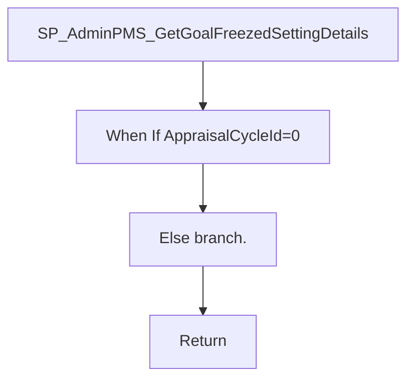

# SP_AdminPMS_GetGoalFreezedSettingDetails

## What it does

Stored procedure `SP_AdminPMS_GetGoalFreezedSettingDetails`. Reads `TPMSEmployeeGoalSetting`, `TPMS_GoalSettingReviewFrequency`. Calls no other procedure or function.

## Parameters

| Name | Direction | What it is for |
|---|---|---|
| `@Employerid` | in | Int |
| `@AppraisalCycleId` | in | int, default 0 |

## Call sequence

Calls no other procedures or functions.

## Callers

No other procedure or function calls this object.

## Nested

Calls no other procedures or functions.

## Steps

1. Script is `HRMS-DATABASE/HRMS/STOREPROCEDURE/SP_AdminPMS_GetGoalFreezedSettingDetails.sql`.
2. When If(@AppraisalCycleId=0)
3. Else branch.

## Tables

| Table | Read or write |
|---|---|
| `TPMSEmployeeGoalSetting` | read |
| `TPMS_GoalSettingReviewFrequency` | read |

## Flow

