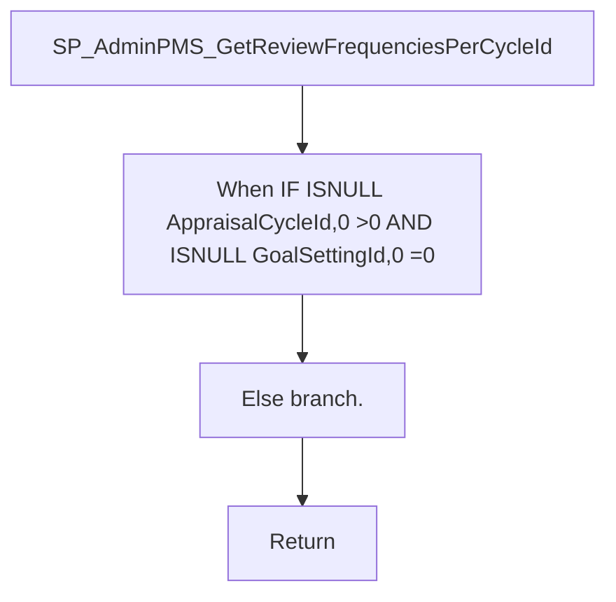

# SP_AdminPMS_GetReviewFrequenciesPerCycleId

## What it does

Stored procedure `SP_AdminPMS_GetReviewFrequenciesPerCycleId`. Reads `TPMS_AppraisalReviewFrequency`, `TPMS_GoalSettingReviewFrequency`. Calls no other procedure or function.

## Parameters

| Name | Direction | What it is for |
|---|---|---|
| `@AppraisalCycleId` | in | Int, default 0 |
| `@GoalSettingId` | in | Int, default 0 |

## Call sequence

Calls no other procedures or functions.

## Callers

No other procedure or function calls this object.

## Nested

Calls no other procedures or functions.

## Steps

1. Script is `HRMS-DATABASE/HRMS/STOREPROCEDURE/SP_AdminPMS_GetReviewFrequenciesPerCycleId.sql`.
2. When IF ISNULL(@AppraisalCycleId,0)>0 AND ISNULL(@GoalSettingId,0)=0
3. Else branch.

## Tables

| Table | Read or write |
|---|---|
| `TPMS_AppraisalReviewFrequency` | read |
| `TPMS_GoalSettingReviewFrequency` | read |

## Flow

