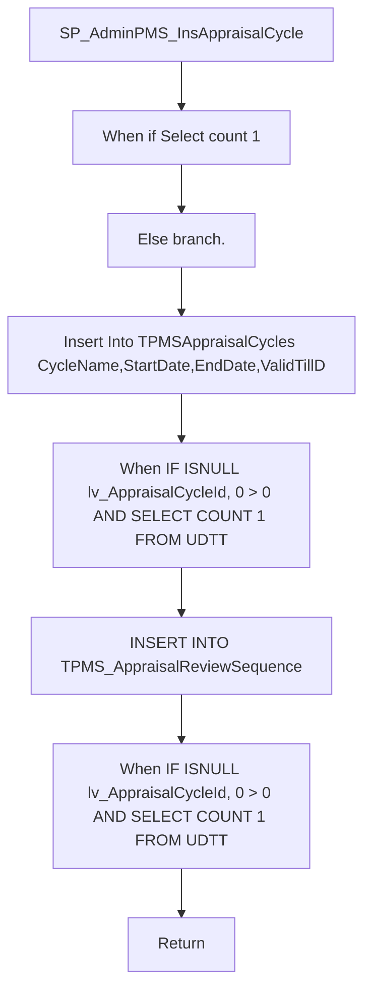

# SP_AdminPMS_InsAppraisalCycle

## What it does

Stored procedure `SP_AdminPMS_InsAppraisalCycle`. Writes `TPMSAppraisalCycles`, `TPMS_AppraisalReviewSequence`, `TPMS_AppraisalNineBoxGrid`, `TPMS_AppraisalReviewFrequency`, `TPMS_AssesmentGoalReviewFrequencies`, `TPMSAppraisalCyclesForDesignation`, `TPMSAppraisalCyclesForRole`, `TPMSAppraisalCyclesForBU`. Reads `TPMSEmployerConfiguration`, `tpms_appraisalreviewfrequency`, `tpmsemployeegoalsetting`. Calls no other procedure or function.

## Parameters

| Name | Direction | What it is for |
|---|---|---|
| `@CycleName` | in | Varchar(50) |
| `@Startdate` | in | Date |
| `@EndDate` | in | Date |
| `@ValidTillDate` | in | Date |
| `@RatingScaleID` | in | Int |
| `@ProcessType` | in | Char(1) |
| `@FormType` | in | Char(1) |
| `@Employerid` | in | Int |
| `@CreatedBy` | in | Int |
| `@IsActive` | in | Char(1) |
| `@ReviewFrequency` | in | varchar(1), default NULL |
| `@UDTTAppraisalReviewFrequency` | in | UDTTAppraisalReviewFrequency |
| `@UDTTAppraisalReviewSequence` | in | UDTTAppraisalReviewSequence |
| `@ReviewerLevel` | in | int, default NULL |
| `@ScoreMethod` | in | varchar(1), default 'M' |
| `@OutcomeScaleID` | in | INT |
| `@AppraisalCycleType` | in | Char(1), default 'A' |
| `@GoalSettingId` | in | INT, default 0 |
| `@IsMappingSelected` | in | bit, default 0 |
| `@IsRoleSelected` | in | bit, default 0 |
| `@IsDesignationSelected` | in | bit, default 0 |
| `@IsBusinessUnitSelected` | in | bit, default 0 |
| `@DesignationId` | in | Varchar(4000), default '' |
| `@RoleId` | in | Varchar(4000), default '' |
| `@BusinessUnitId` | in | Varchar(4000), default '' |
| `@GoalReviewFrequencyIds` | in | Varchar(2000), default NULL |
| `@IsRoundOffAppRating` | in | bit, default 0 |
| `@IsTrainingRequired` | in | bit, default 0 |
| `@TrainingAppliedTo` | in | varchar(1), default 'E' |
| `@IsEnableNineBoxGrid` | in | bit, default 0 |
| `@UDTTAppraisalNineBoxGrid` | in | UDTTAppraisalNineBoxGrid |

## Call sequence

Calls no other procedures or functions.

## Callers

No other procedure or function calls this object.

## Nested

Calls no other procedures or functions.

## Steps

1. Script is `HRMS-DATABASE/HRMS/STOREPROCEDURE/SP_AdminPMS_InsAppraisalCycle.sql`.
2. When if (Select count(1)
3. Else branch.
4. Insert Into TPMSAppraisalCycles(CycleName,StartDate,EndDate,ValidTillDate,RatingId,ProcessType,FormType,EmployerID,
5. When IF ISNULL(@lv_AppraisalCycleId, 0) > 0 AND (SELECT COUNT(1) FROM @UDTTAppraisalReviewSequence) > 0
6. INSERT INTO TPMS_AppraisalReviewSequence (
7. When IF ISNULL(@lv_AppraisalCycleId, 0) > 0 AND (SELECT COUNT(1) FROM @UDTTAppraisalNineBoxGrid) > 0
8. INSERT INTO TPMS_AppraisalNineBoxGrid (AppraisalCycleId,NineBoxGridType,Scale,MinRangeFreq,MaxRangeFreq)
9. Update TPMSAppraisalCycles
10. When IF ISNULL(@lv_AppraisalCycleId, 0) > 0 AND (SELECT COUNT(1) FROM @UDTTAppraisalReviewFrequency) > 0
11. INSERT INTO TPMS_AppraisalReviewFrequency (
12. Else branch.
13. INSERT INTO TPMS_AppraisalReviewFrequency (
14. Else branch.
15. Update TPMSAppraisalCycles
16. When if((select IsAssessmentForMultipleGoalForms from TPMSEmployerConfiguration where employerid=@Employerid)=0 AND len(@GoalReviewFrequencyIds) =0 AND @GoalSettingI
17. INSERT INTO TPMS_AssesmentGoalReviewFrequencies(AppraisalCycleId,GoalSettingId,ReviewFrequncyId,CreatedBy,CreatedDate,AssessmentReviewFrequencyId)
18. When IF ISNULL(@lv_AppraisalCycleId, 0) > 0 AND ((SELECT COUNT(1) FROM dbo.Split(@GoalReviewFrequencyIds,',') ) > 0 AND len(@GoalReviewFrequencyIds)!=0 AND @GoalSett
19. When if((select count(*) from TPMS_AssesmentGoalReviewFrequencies
20. INSERT INTO TPMS_AssesmentGoalReviewFrequencies(AppraisalCycleId,GoalSettingId,ReviewFrequncyId,CreatedBy,CreatedDate,AssessmentReviewFrequencyId)
21. Else branch.
22. INSERT INTO TPMS_AssesmentGoalReviewFrequencies(AppraisalCycleId,GoalSettingId,ReviewFrequncyId,CreatedBy,CreatedDate,AssessmentReviewFrequencyId)
23. When if(@IsDesignationSelected =1)
24. Insert Into TPMSAppraisalCyclesForDesignation(AppraisalCycleId,DesignationId)
25. When if(@IsRoleSelected =1)
26. Insert Into TPMSAppraisalCyclesForRole(AppraisalCycleId,RoleId)
27. When if(@IsBusinessUnitSelected =1)
28. Insert Into TPMSAppraisalCyclesForBU(AppraisalCycleId,BusinessUnitId)

## Tables

| Table | Read or write |
|---|---|
| `TPMSAppraisalCycles` | read and write |
| `TPMSAppraisalCyclesForBU` | write |
| `TPMSAppraisalCyclesForDesignation` | write |
| `TPMSAppraisalCyclesForRole` | write |
| `TPMSEmployerConfiguration` | read |
| `TPMS_AppraisalNineBoxGrid` | write |
| `TPMS_AppraisalReviewFrequency` | read and write |
| `TPMS_AppraisalReviewSequence` | read and write |
| `TPMS_AssesmentGoalReviewFrequencies` | read and write |
| `tpms_appraisalreviewfrequency` | read |
| `tpmsemployeegoalsetting` | read |

## Flow

