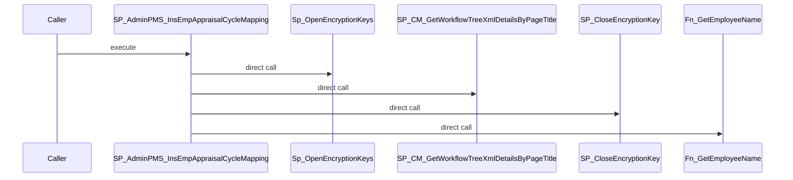
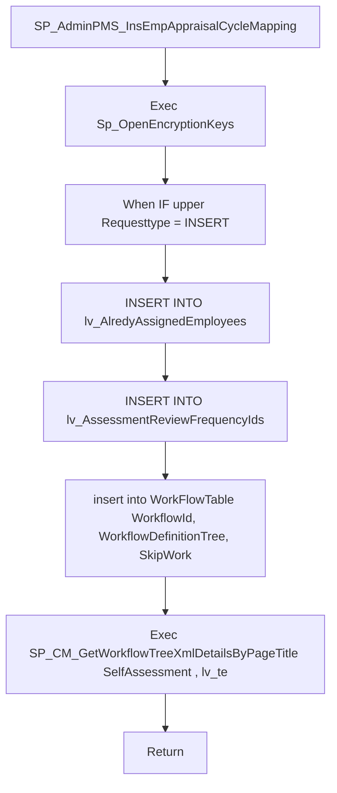

# SP_AdminPMS_InsEmpAppraisalCycleMapping

## What it does

Stored procedure `SP_AdminPMS_InsEmpAppraisalCycleMapping`. Writes `TPMSEmployeeAppraisalCycleMapping`, `TPMSEmployeeSelfAppraisal`, `TRequestWorkflows`, `TPMSEmployeeCompetencyRatings`, `TPMSEmployeeCompetencyRatingsHistory`, `TPMS_ParkWhatsAppAssessmentMapping`, `TPMS_AssessmentEmployeeAllUpdates`, `from`, and others. Reads `TPMSAppraisalCycles`, `TPMS_AppraisalReviewFrequency`, `TEMPLOYEE`, `TEmployee`, `TEmployeeInfo`, `TPMSCategoryDesignationMapping`, `TPMSDesignationMappingForDesignation`, `TPMSDesignationMappingForRole`, and others. Calls `Sp_OpenEncryptionKeys`, `SP_CM_GetWorkflowTreeXmlDetailsByPageTitle`, `SP_CloseEncryptionKey`, `Fn_GetEmployeeName`.

## Parameters

| Name | Direction | What it is for |
|---|---|---|
| `@AppraisalCycleid` | in | INT |
| `@Employerid` | in | INT |
| `@EmployeeId` | in | VARCHAR(Max) |
| `@CreatedBy` | in | INT |
| `@Requesttype` | in | VARCHAR(10) |

## Call sequence

## Callers

| Object | Kind | Page |
|---|---|---|
| `Sp_AdminPMS_UploadBulkEmployeeMapping` | procedure | [Sp_AdminPMS_UploadBulkEmployeeMapping](/docs/database/hrms/Sp_AdminPMS_UploadBulkEmployeeMapping) |

## Nested

| Object | Kind | When | Page |
|---|---|---|---|
| `Sp_OpenEncryptionKeys` | procedure | direct call | [Sp_OpenEncryptionKeys](/docs/database/hrms/Sp_OpenEncryptionKeys) |
| `SP_CM_GetWorkflowTreeXmlDetailsByPageTitle` | procedure | direct call | [SP_CM_GetWorkflowTreeXmlDetailsByPageTitle](/docs/database/hrms/SP_CM_GetWorkflowTreeXmlDetailsByPageTitle) |
| `SP_CloseEncryptionKey` | procedure | direct call | [SP_CloseEncryptionKey](/docs/database/hrms/SP_CloseEncryptionKey) |
| `Fn_GetEmployeeName` | function | direct call | [Fn_GetEmployeeName](/docs/database/hrms/Fn_GetEmployeeName) |

## Steps

1. Script is `HRMS-DATABASE/HRMS/STOREPROCEDURE/SP_AdminPMS_InsEmpAppraisalCycleMapping.sql`.
2. Exec Sp_OpenEncryptionKeys
3. When IF upper(@Requesttype) = 'INSERT'
4. INSERT INTO @lv_AlredyAssignedEmployees
5. INSERT INTO @lv_AssessmentReviewFrequencyIds
6. insert into @WorkFlowTable(WorkflowId, WorkflowDefinitionTree, SkipWorkFlow)
7. Exec SP_CM_GetWorkflowTreeXmlDetailsByPageTitle 'SelfAssessment',@lv_tempEmployerId,@lv_tempEmpId
8. Delete from @WorkFlowTable
9. When if(@workflowId=0)
10. Else branch.
11. When if((SELECT count(*) FROM TPMSEmployeeSelfAppraisal
12. UPDATE TPMSEmployeeSelfAppraisal
13. When if(Select IsSelfassessmentIsRequired from TPMSEmployerConfiguration where EmployerId=@Employerid) =1
14. Delete From TPMSEmployeeCompetencyRatings where AppraisalFormId=@lv_Transid AND RatingLevel>0
15. UPDATE TPMSEmployeeCompetencyRatings
16. DELETE FROM TPMSAppraisalCumulativeRating
17. Else branch.
18. Delete From TPMSEmployeeCompetencyRatings where AppraisalFormId=@lv_Transid AND RatingLevel>1
19. UPDATE TPMSEmployeeCompetencyRatings
20. DELETE FROM TPMSAppraisalCumulativeRating
21. Else branch.
22. When if(@lv_categeoryid>0)
23. When if((SELECT count(*) FROM TPMSEmployeeAppraisalCycleMapping
24. INSERT INTO TPMSEmployeeAppraisalCycleMapping (
25. INSERT INTO TPMSEmployeeSelfAppraisal (
26. When if(@lv_EmployeeMgrid!=@lv_Employeeid)
27. Delete From @WorkFlowTable
28. insert into @WorkFlowTable(WorkflowId, WorkflowDefinitionTree, SkipWorkFlow)
29. Exec SP_CM_GetWorkflowTreeXmlDetailsByPageTitle 'SelfAssessment',@lv_tempEmployerId,@lv_Employeeid
30. Further statements continue in the script.

## Tables

| Table | Read or write |
|---|---|
| `From` | write |
| `TEMPLOYEE` | read |
| `TEmployee` | read |
| `TEmployeeInfo` | read |
| `TEmployeeOrgBusinessHead` | read |
| `TORGChart` | read |
| `TPMSAppraisalCumulativeRating` | read and write |
| `TPMSAppraisalCycles` | read |
| `TPMSCategoryDesignationMapping` | read |
| `TPMSDesignationMappingForBU` | read |
| `TPMSDesignationMappingForDesignation` | read |
| `TPMSDesignationMappingForRole` | read |
| `TPMSEmployeeAppraisalCycleMapping` | read and write |
| `TPMSEmployeeCompetencyRatings` | read and write |
| `TPMSEmployeeCompetencyRatingsHistory` | write |
| `TPMSEmployeeGoals` | read and write |
| `TPMSEmployeeSelfAppraisal` | read and write |
| `TPMSEmployerConfiguration` | read |
| `TPMS_AppraisalReviewFrequency` | read |
| `TPMS_AssessmentEmployeeAllUpdates` | write |
| `TPMS_ParkWhatsAppAssessmentMapping` | write |
| `TRequestWorkflows` | read and write |
| `Temployeeinfo` | read |
| `from` | write |
| `temployeeinfo` | read |
| `tpms_appraisalreviewsequence` | read |

## Flow

