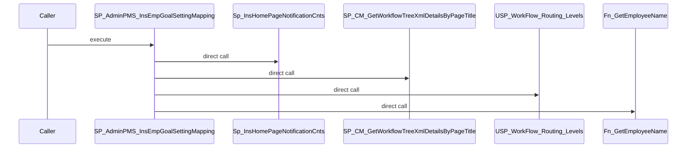
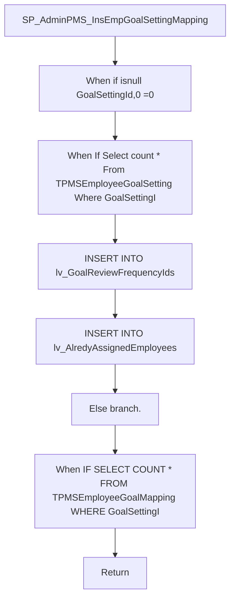

# SP_AdminPMS_InsEmpGoalSettingMapping

## What it does

Stored procedure `SP_AdminPMS_InsEmpGoalSettingMapping`. Writes `TPMSEmployeeGoalMapping`, `TPMSEmployeeGoalFormData`, `TPMSEmployeeGoalFormDataDetails`, `TRequestWorkflows`, `TPMSEMPLOYEEGOALMAPPING`, `from`. Reads `TPMSEmployeeGoalSetting`, `tpms_goalsettingreviewfrequency`, `TEmployeeInfo`, `TPMSEmployeeGoalSettingTemplate`, `TPMSCategoryDesignationMapping`, `TPMSDesignationMappingForDesignation`, `TPMSDesignationMappingForRole`, `TPMSDesignationMappingForBU`, and others. Calls `Sp_InsHomePageNotificationCnts`, `SP_CM_GetWorkflowTreeXmlDetailsByPageTitle`, `USP_WorkFlow_Routing_Levels`, `Fn_GetEmployeeName`.

## Parameters

| Name | Direction | What it is for |
|---|---|---|
| `@GoalSettingId` | in | INT |
| `@Employerid` | in | INT |
| `@EmployeeId` | in | VARCHAR(Max) |
| `@CreatedBy` | in | INT |

## Call sequence

## Callers

| Object | Kind | Page |
|---|---|---|
| `Sp_AdminPMS_UploadBulkEmployeeMapping` | procedure | [Sp_AdminPMS_UploadBulkEmployeeMapping](/docs/database/hrms/Sp_AdminPMS_UploadBulkEmployeeMapping) |

## Nested

| Object | Kind | When | Page |
|---|---|---|---|
| `Sp_InsHomePageNotificationCnts` | procedure | direct call | [Sp_InsHomePageNotificationCnts](/docs/database/hrms/Sp_InsHomePageNotificationCnts) |
| `SP_CM_GetWorkflowTreeXmlDetailsByPageTitle` | procedure | direct call | [SP_CM_GetWorkflowTreeXmlDetailsByPageTitle](/docs/database/hrms/SP_CM_GetWorkflowTreeXmlDetailsByPageTitle) |
| `USP_WorkFlow_Routing_Levels` | procedure | direct call | [USP_WorkFlow_Routing_Levels](/docs/database/hrms/USP_WorkFlow_Routing_Levels) |
| `Fn_GetEmployeeName` | function | direct call | [Fn_GetEmployeeName](/docs/database/hrms/Fn_GetEmployeeName) |

## Steps

1. Script is `HRMS-DATABASE/HRMS/STOREPROCEDURE/SP_AdminPMS_InsEmpGoalSettingMapping.sql`.
2. When if(isnull(@GoalSettingId,0)=0)
3. When If ((Select count(*) From TPMSEmployeeGoalSetting Where GoalSettingId= @GoalSettingId and IsGoalFreezed=1)=1)
4. INSERT INTO @lv_GoalReviewFrequencyIds
5. INSERT INTO @lv_AlredyAssignedEmployees
6. Else branch.
7. When IF(( SELECT COUNT(*) FROM TPMSEmployeeGoalMapping WHERE GoalSettingId = @GoalSettingId AND Employeeid = @lv_Employeeid and ReviewFrequencyId=@lv_ReviewFrequency
8. INSERT INTO TPMSEmployeeGoalMapping (GoalSettingId, Employeeid, FormSubmitted, Employerid, FormApproved, IsActive, CreatedBy, Createddate, GoalStatus,IsInitiated,ReviewLevel1,Revie
9. When IF(LEN(@LV_DefSectionName)>0)
10. When if((select count(1) from TPMSCategoryMasterGoalFormData gf
11. Insert into TPMSEmployeeGoalFormData
12. Insert into TPMSEmployeeGoalFormDataDetails
13. Else branch.
14. When If ((Select count(*) From TPMSEmployeeGoalMapping
15. Update TPMSEMPLOYEEGOALMAPPING
16. When if(@LV_IsSelfassessmentIsRequired=0)
17. Else branch.
18. When if(@LV_IsSelfassessmentIsRequired=1)
19. EXEC [dbo].[Sp_InsHomePageNotificationCnts] @lv_Employeeid
20. Else branch.
21. insert into @WorkFlowTable(WorkflowId, WorkflowDefinitionTree, SkipWorkFlow)
22. Exec SP_CM_GetWorkflowTreeXmlDetailsByPageTitle @PageTitle,@lv_tempEmployerId,@lv_Employeeid
23. Delete from @WorkFlowTable
24. INSERT INTO #Managers
25. EXEC [dbo].[USP_WorkFlow_Routing_Levels] @wfId = @LV_WorkflowId
26. When If(ISNULL((@lv_ManagerId),0)>0 OR (select Count(1) from #Managers)>0)
27. Update TPMSEMPLOYEEGOALMAPPING
28. When if(@lv_IsGoalFormWithWorkFlow =0)
29. INSERT INTO TRequestWorkflows (RequestTransid, RequestType, ManagerId, WorkflowId, ApprovalLevel, IsApprove, ApproveStatus, CreatedBy, CreatedDate, RequestForEmployee)
30. Further statements continue in the script.

## Tables

| Table | Read or write |
|---|---|
| `TEMPLOYEE` | read |
| `TEmailTemplates` | read |
| `TEmployee` | read |
| `TEmployeeInfo` | read |
| `TEmployeeOrgBusinessHead` | read |
| `THomepageNotifications` | read |
| `TORGChart` | read |
| `TPMSCategoryDesignationMapping` | read |
| `TPMSCategoryMaster` | read |
| `TPMSCategoryMasterGoalFormData` | read |
| `TPMSDesignationMappingForBU` | read |
| `TPMSDesignationMappingForDesignation` | read |
| `TPMSDesignationMappingForRole` | read |
| `TPMSEMPLOYEEGOALMAPPING` | write |
| `TPMSEmployeeGoalFormData` | write |
| `TPMSEmployeeGoalFormDataDetails` | write |
| `TPMSEmployeeGoalMapping` | read and write |
| `TPMSEmployeeGoalSetting` | read |
| `TPMSEmployeeGoalSettingReviewLevel` | read |
| `TPMSEmployeeGoalSettingTemplate` | read |
| `TPMSEmployerConfiguration` | read |
| `TPMSGoalCategory` | read |
| `TPMSGoalCategoryDetails` | read |
| `TPMS_TEmployeeGoalSections` | read |
| `TRequestWorkflows` | write |
| `Temployeeinfo` | read |
| `from` | write |
| `tpms_goalsettingreviewfrequency` | read |
| `tpmsemployeegoalmapping` | read |

## Flow

