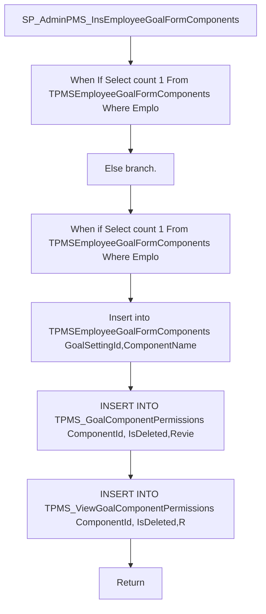

# SP_AdminPMS_InsEmployeeGoalFormComponents

## What it does

Stored procedure `SP_AdminPMS_InsEmployeeGoalFormComponents`. Writes `TPMSEmployeeGoalFormComponents`, `TPMS_GoalComponentPermissions`, `TPMS_ViewGoalComponentPermissions`. Calls no other procedure or function.

## Parameters

| Name | Direction | What it is for |
|---|---|---|
| `@GoalSettingId` | in | Int |
| `@ComponentName` | in | Varchar(250) |
| `@ComponentType` | in | Varchar(20) |
| `@NoofChoices` | in | Int |
| `@ChoiceText` | in | Varchar(1000) |
| `@DisplaySequence` | in | Int |
| `@Employerid` | in | Int |
| `@CreatedBy` | in | Int |
| `@IsEvidenceRequired` | in | Bit |
| `@ReviewFrequencyId` | in | int, default 0 |
| `@IsCameFromAdmin` | in | bit, default 0 |
| `@EmployeeId` | in | int, default 0 |
| `@IsEvidenceRequiredMandatory` | in | bit, default 0 |
| `@UDTGoalComponentPermissions` | in | UDTAppraisalViewManagerPermissions |
| `@UDTViewGoalComponentPermissions` | in | UDTAppraisalViewManagerPermissions |
| `@ViewGoalComponentRequired` | in | bit, default 0 |

## Call sequence

Calls no other procedures or functions.

## Callers

No other procedure or function calls this object.

## Nested

Calls no other procedures or functions.

## Steps

1. Script is `HRMS-DATABASE/HRMS/STOREPROCEDURE/SP_AdminPMS_InsEmployeeGoalFormComponents.sql`.
2. When If (Select count(1) From TPMSEmployeeGoalFormComponents Where Employerid=@Employerid And upper(ComponentName)=upper(@ComponentName) And isdeleted=0 And ReviewFr
3. Else branch.
4. When if((Select count(1) From TPMSEmployeeGoalFormComponents Where Employerid=@Employerid And DisplaySequence=@DisplaySequence And isdeleted=0 And ReviewFrequencyId=
5. Insert into TPMSEmployeeGoalFormComponents (GoalSettingId,ComponentName,ComponentType,NoofChoices,ChoiceText,DisplaySequence,Employerid,CreatedBy,CreateDate,isdeleted,IsEvidenceReq
6. INSERT INTO TPMS_GoalComponentPermissions (ComponentId, IsDeleted,ReviewLevelId, ReviewLevel)
7. INSERT INTO TPMS_ViewGoalComponentPermissions (ComponentId, IsDeleted,ReviewLevelId, ReviewLevel)

## Tables

| Table | Read or write |
|---|---|
| `TPMSEmployeeGoalFormComponents` | read and write |
| `TPMS_GoalComponentPermissions` | write |
| `TPMS_ViewGoalComponentPermissions` | write |

## Flow

