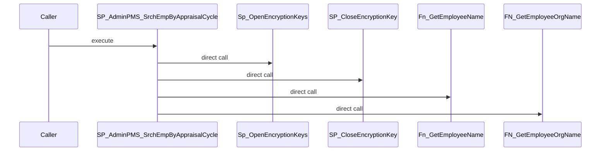
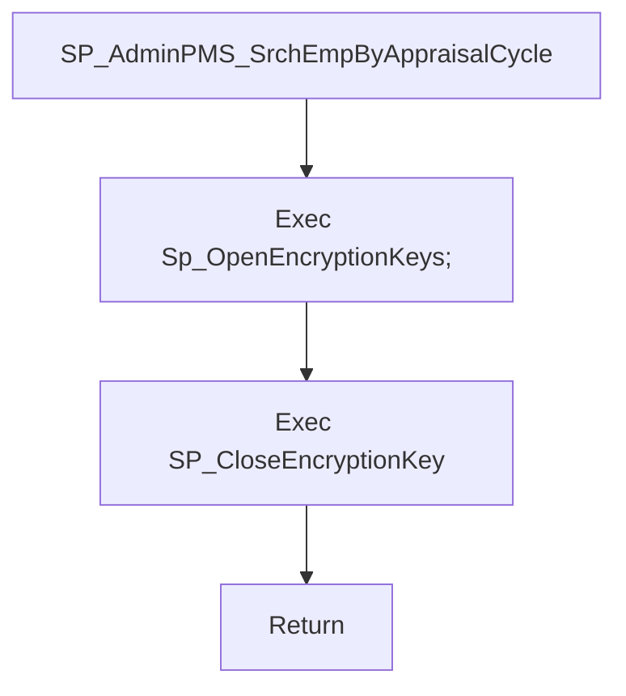

# SP_AdminPMS_SrchEmpByAppraisalCycle

## What it does

Stored procedure `SP_AdminPMS_SrchEmpByAppraisalCycle`. Reads `TRequestWorkflows`, `TEmployee`, `Temployeeinfo`, `temployeeinfo`, `tpmsappraisalcycles`, `TPMSEmployeeSelfAppraisal`, `tpms_appraisalreviewfrequency`, `TEmployerDetails`, and others. Calls `Sp_OpenEncryptionKeys`, `SP_CloseEncryptionKey`, `Fn_GetEmployeeName`, `FN_GetEmployeeOrgName`.

## Parameters

| Name | Direction | What it is for |
|---|---|---|
| `@AppraisalCycleId` | in | Int |
| `@EmployeeName` | in | Varchar(200) |
| `@ReviewFrequncyId` | in | int, default 0 |

## Call sequence

## Callers

No other procedure or function calls this object.

## Nested

| Object | Kind | When | Page |
|---|---|---|---|
| `Sp_OpenEncryptionKeys` | procedure | direct call | [Sp_OpenEncryptionKeys](/docs/database/hrms/Sp_OpenEncryptionKeys) |
| `SP_CloseEncryptionKey` | procedure | direct call | [SP_CloseEncryptionKey](/docs/database/hrms/SP_CloseEncryptionKey) |
| `Fn_GetEmployeeName` | function | direct call | [Fn_GetEmployeeName](/docs/database/hrms/Fn_GetEmployeeName) |
| `FN_GetEmployeeOrgName` | function | direct call | [FN_GetEmployeeOrgName](/docs/database/hrms/FN_GetEmployeeOrgName) |

## Steps

1. Script is `HRMS-DATABASE/HRMS/STOREPROCEDURE/SP_AdminPMS_SrchEmpByAppraisalCycle.sql`.
2. Exec Sp_OpenEncryptionKeys;
3. Exec SP_CloseEncryptionKey

## Tables

| Table | Read or write |
|---|---|
| `TEmployee` | read |
| `TEmployerDetails` | read |
| `TPMSEmployeeSelfAppraisal` | read |
| `TPMSEmployerConfiguration` | read |
| `TRequestWorkflows` | read |
| `Temployeeinfo` | read |
| `temployeeinfo` | read |
| `tpms_appraisalreviewfrequency` | read |
| `tpmsappraisalcycles` | read |

## Flow

