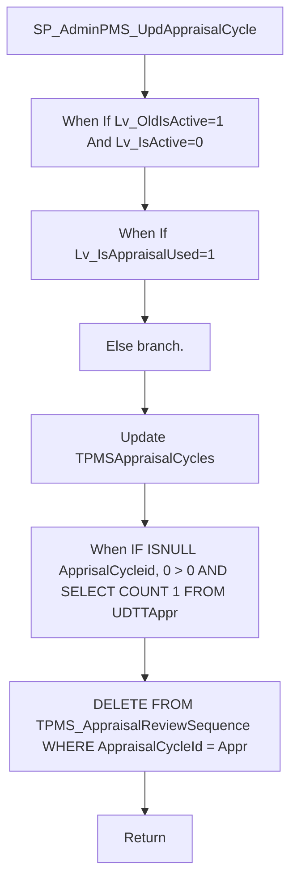

# SP_AdminPMS_UpdAppraisalCycle

## What it does

Stored procedure `SP_AdminPMS_UpdAppraisalCycle`. Writes `TPMS_AppraisalReviewSequence`, `TPMS_AppraisalNineBoxGrid`, `TPMS_AppraisalReviewFrequency`, `TPMS_AssesmentGoalReviewFrequencies`, `TPMSAppraisalCyclesForDesignation`, `TPMSAppraisalCyclesForRole`, `TPMSAppraisalCyclesForBU`, `TPMSAppraisalCycles`, and others. Reads `tpms_appraisalreviewfrequency`, `TPMSEmployerConfiguration`, `tpmsemployeegoalsetting`. Calls no other procedure or function.

## Parameters

| Name | Direction | What it is for |
|---|---|---|
| `@ApprisalCycleid` | in | Int |
| `@CycleName` | in | Varchar(50) |
| `@Startdate` | in | Date |
| `@EndDate` | in | Date |
| `@ValidTillDate` | in | Date |
| `@RatingScaleID` | in | Int |
| `@ProcessType` | in | Char(1) |
| `@FormType` | in | Char(1) |
| `@Employerid` | in | Int |
| `@ModifiedBy` | in | Int |
| `@IsActive` | in | Char(1) |
| `@ReviewFrequency` | in | varchar(1), default NULL |
| `@UDTTAppraisalReviewFrequency` | in | UDTTAppraisalReviewFrequency |
| `@UDTTAppraisalReviewSequence` | in | UDTTAppraisalReviewSequence |
| `@ReviewerLevel` | in | int, default NULL |
| `@ScoreMethod` | in | varchar(1), default NULL |
| `@OutcomeScaleID` | in | INT |
| `@AppraisalCycleType` | in | Char(1), default 'A' |
| `@GoalSettingId` | in | INT, default 0 |
| `@IsMappingSelected` | in | bit, default 0 |
| `@IsRoleSelected` | in | bit, default 0 |
| `@IsDesignationSelected` | in | bit, default 0 |
| `@IsBusinessUnitSelected` | in | bit, default 0 |
| `@DesignationId` | in | Varchar(4000), default '' |
| `@RoleId` | in | Varchar(4000), default '' |
| `@BusinessUnitId` | in | Varchar(4000), default '' |
| `@GoalReviewFrequencyIds` | in | Varchar(2000), default NULL |
| `@IsRoundOffAppRating` | in | bit, default 0 |
| `@IsTrainingRequired` | in | bit, default 0 |
| `@TrainingAppliedTo` | in | varchar(1), default 'E' |
| `@IsEnableNineBoxGrid` | in | bit, default 0 |
| `@UDTTAppraisalNineBoxGrid` | in | UDTTAppraisalNineBoxGrid |

## Call sequence

Calls no other procedures or functions.

## Callers

No other procedure or function calls this object.

## Nested

Calls no other procedures or functions.

## Steps

1. Script is `HRMS-DATABASE/HRMS/STOREPROCEDURE/SP_AdminPMS_UpdAppraisalCycle.sql`.
2. When If @Lv_OldIsActive=1 And @Lv_IsActive=0
3. When If @Lv_IsAppraisalUsed=1
4. Else branch.
5. Update TPMSAppraisalCycles
6. When IF ISNULL(@ApprisalCycleid, 0) > 0 AND (SELECT COUNT(1) FROM @UDTTAppraisalReviewSequence) > 0 AND @lv_IsInitiated=0
7. DELETE FROM TPMS_AppraisalReviewSequence WHERE AppraisalCycleId =@ApprisalCycleid
8. INSERT INTO TPMS_AppraisalReviewSequence (AppraisalCycleId,ReviewSequenceId,ReviewSequence)
9. When IF ISNULL(@ApprisalCycleid, 0) > 0 AND (SELECT COUNT(1) FROM @UDTTAppraisalNineBoxGrid) > 0 AND @lv_IsInitiated=0
10. DELETE FROM TPMS_AppraisalNineBoxGrid WHERE AppraisalCycleId =@ApprisalCycleid
11. INSERT INTO TPMS_AppraisalNineBoxGrid (AppraisalCycleId,NineBoxGridType,Scale,MinRangeFreq,MaxRangeFreq)
12. Update TPMSAppraisalCycles
13. When IF ISNULL(@ApprisalCycleid, 0) > 0 AND (SELECT COUNT(1) FROM @UDTTAppraisalReviewFrequency) > 0
14. When if((select count(1) from TPMS_AppraisalReviewFrequency where AppraisalCycleId=@ApprisalCycleid) !=
15. DELETE FROM TPMS_AppraisalReviewFrequency WHERE AppraisalCycleId =@ApprisalCycleid
16. INSERT INTO TPMS_AppraisalReviewFrequency (
17. Else branch.
18. UPDATE TPMS_AppraisalReviewFrequency
19. Update TPMSAppraisalCycles
20. update TPMSEmployeeSelfAppraisal
21. When IF ISNULL(@ApprisalCycleid, 0) > 0 AND ((SELECT COUNT(1) FROM dbo.Split(@GoalReviewFrequencyIds,',') ) > 0 AND len(@GoalReviewFrequencyIds)!=0)
22. Delete from TPMS_AssesmentGoalReviewFrequencies where AppraisalCycleId = @ApprisalCycleid
23. When if((select count(*) from TPMS_AssesmentGoalReviewFrequencies where AppraisalCycleId =@ApprisalCycleid and AssessmentReviewFrequencyId =@LV_tempReviewFrequncyId
24. INSERT INTO TPMS_AssesmentGoalReviewFrequencies(AppraisalCycleId,GoalSettingId,ReviewFrequncyId,CreatedBy,CreatedDate,AssessmentReviewFrequencyId)
25. Else branch.
26. INSERT INTO TPMS_AssesmentGoalReviewFrequencies(AppraisalCycleId,GoalSettingId,ReviewFrequncyId,CreatedBy,CreatedDate,AssessmentReviewFrequencyId)
27. Else branch.
28. INSERT INTO TPMS_AssesmentGoalReviewFrequencies(AppraisalCycleId,GoalSettingId,ReviewFrequncyId,CreatedBy,CreatedDate,AssessmentReviewFrequencyId)
29. When if(@IsDesignationSelected =1 AND @lv_IsInitiated=0)
30. Further statements continue in the script.

## Tables

| Table | Read or write |
|---|---|
| `TPMSAppraisalCycles` | read and write |
| `TPMSAppraisalCyclesForBU` | read and write |
| `TPMSAppraisalCyclesForDesignation` | read and write |
| `TPMSAppraisalCyclesForRole` | read and write |
| `TPMSEmployeeSelfAppraisal` | write |
| `TPMSEmployerConfiguration` | read |
| `TPMS_AppraisalNineBoxGrid` | read and write |
| `TPMS_AppraisalReviewFrequency` | read and write |
| `TPMS_AppraisalReviewSequence` | read and write |
| `TPMS_AssesmentGoalReviewFrequencies` | read and write |
| `tpms_appraisalreviewfrequency` | read |
| `tpmsemployeegoalsetting` | read |

## Flow

