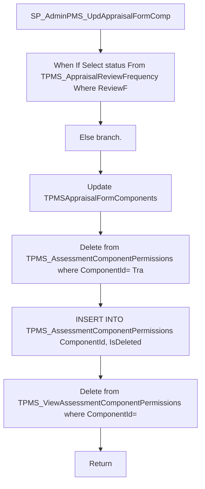

# SP_AdminPMS_UpdAppraisalFormComp

## What it does

Stored procedure `SP_AdminPMS_UpdAppraisalFormComp`. Writes `TPMS_AssessmentComponentPermissions`, `TPMS_ViewAssessmentComponentPermissions`, `TPMSAppraisalFormComponents`. Reads `TPMS_AppraisalReviewFrequency`. Calls no other procedure or function.

## Parameters

| Name | Direction | What it is for |
|---|---|---|
| `@Transid` | in | Int |
| `@AppraisalCycleid` | in | Int |
| `@ComponentName` | in | Varchar(250) |
| `@ComponentType` | in | Varchar(20) |
| `@NoofChoices` | in | Int |
| `@ChoiceText` | in | Varchar(1000) |
| `@DisplaySequnece` | in | Int |
| `@Employerid` | in | Int |
| `@CreatedBy` | in | Int |
| `@IsEvidenceRequired` | in | Bit |
| `@FormType` | in | Varchar(1), default null |
| `@ReviewFrequencyId` | in | int, default 0 |
| `@IsEvidenceRequiredMandatory` | in | bit, default 0 |
| `@UDTAssessmentComponentPermissions` | in | UDTAppraisalViewManagerPermissions |
| `@UDTViewAssessmentComponentPermissions` | in | UDTAppraisalViewManagerPermissions |
| `@ViewAssessmentComponentRequired` | in | bit, default 0 |

## Call sequence

Calls no other procedures or functions.

## Callers

No other procedure or function calls this object.

## Nested

Calls no other procedures or functions.

## Steps

1. Script is `HRMS-DATABASE/HRMS/STOREPROCEDURE/SP_AdminPMS_UpdAppraisalFormComp.sql`.
2. When If ((Select status From TPMS_AppraisalReviewFrequency Where ReviewFrequencyId=@ReviewFrequencyId)='Initiated'
3. Else branch.
4. Update TPMSAppraisalFormComponents
5. Delete from TPMS_AssessmentComponentPermissions where ComponentId=@Transid;
6. INSERT INTO TPMS_AssessmentComponentPermissions (ComponentId, IsDeleted,ReviewLevelId, ReviewLevel)
7. Delete from TPMS_ViewAssessmentComponentPermissions where ComponentId=@Transid;
8. INSERT INTO TPMS_ViewAssessmentComponentPermissions (ComponentId, IsDeleted,ReviewLevelId, ReviewLevel)

## Tables

| Table | Read or write |
|---|---|
| `TPMSAppraisalFormComponents` | read and write |
| `TPMS_AppraisalReviewFrequency` | read |
| `TPMS_AssessmentComponentPermissions` | read and write |
| `TPMS_ViewAssessmentComponentPermissions` | read and write |

## Flow

