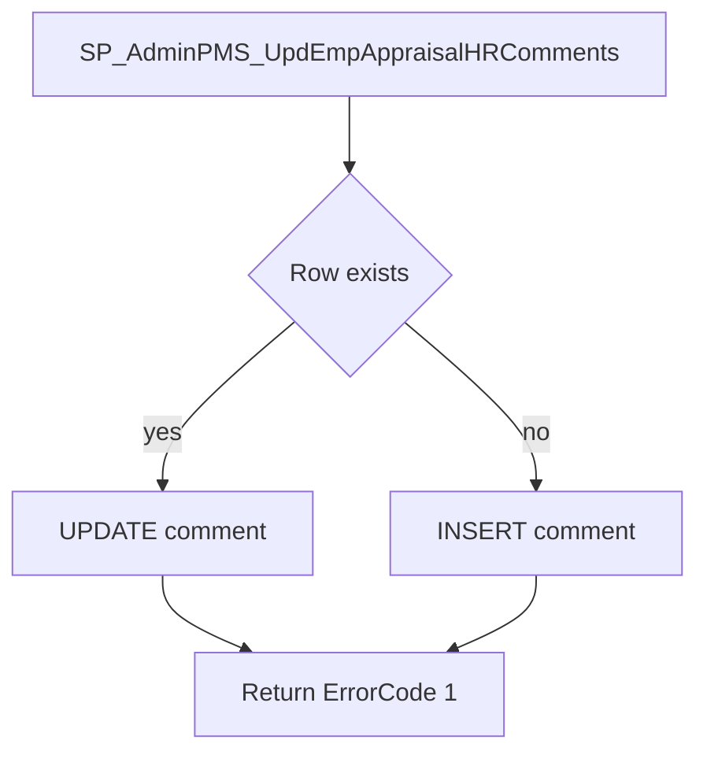

# SP_AdminPMS_UpdEmpAppraisalHRComments

## What it does

Upserts the HR comment for one employee on one appraisal cycle (or goal setting id when the UI passes that as `AppraisalCycleId`). Returns `ErrorCode = 1` on success.

## Parameters

| Name | Direction | What it is for |
|---|---|---|
| `@AppraisalCycleId` | in | Cycle or goal-setting id keyed on the comment row |
| `@EmployeeId` | in | Employee the comment belongs to |
| `@HRComments` | in | Comment text |
| `@CreatedBy` | in | Acting HR user (also stored as `HREmployeeId` on insert) |

## Call sequence

Calls no other procedures or functions.

## Callers

No other procedure or function calls this object.

## Nested

Calls no other procedures or functions.

## Steps

Script: `HRMS-DATABASE/HRMS/STOREPROCEDURE/SP_AdminPMS_UpdEmpAppraisalHRComments.sql`.

1. If a `TPMSEmpAppraisalHRComments` row exists for the cycle and employee, update `HRComments`, `UpdatedBy`, `Updatedate`.
2. Else insert a new row with `HREmployeeId` / audit columns set from `@CreatedBy`.
3. Select `1` as `ErrorCode`.

## Tables

| Table | Read or write |
|---|---|
| `TPMSEmpAppraisalHRComments` | read/write |

## Flow

