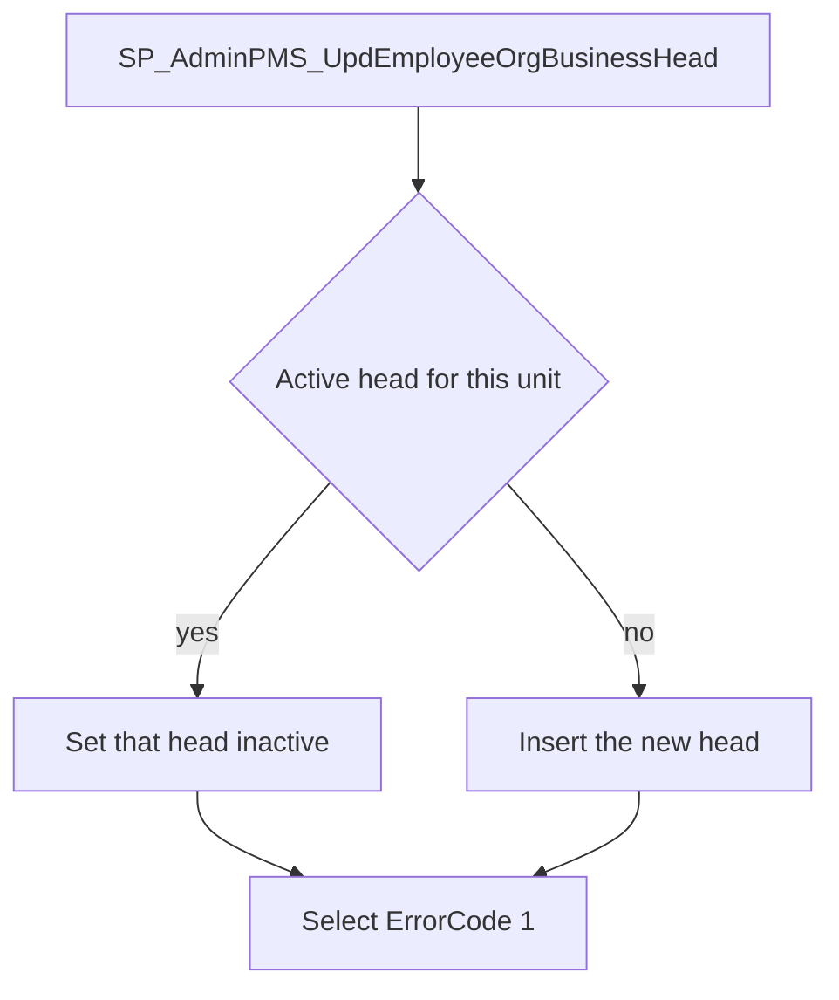

# SP_AdminPMS_UpdEmployeeOrgBusinessHead

## What it does

Stores a business-unit head only when that unit has no active head. When an active `TEmployeeOrgBusinessHead` row already exists for the employer and unit, the procedure sets that row inactive and does not insert `@BusUnitHeadEmpId`. Both branches select `ErrorCode` 1. The script never selects `ErrorCode` 2.

## Parameters

| Name | Direction | What it is for |
|---|---|---|
| `@BusUnitHeadEmpId` | in | Employee to insert. Used only when no active head exists |
| `@EmployerID` | in | Employer on the head row |
| `@IsActive` | in | Value written on the insert. The page passes 1 |
| `@CreatedBy` | in | Stored as both `CreatedBy` and `UpdatedBy`. Also written as `UpdatedBy` when an existing head is deactivated |
| `@BusinessUnitId` | in | Unit the head belongs to |

## Call sequence

Calls no other procedures or functions.

## Callers

No other procedure or function calls this object. Create Organization Structure calls it through `PerformanceManagementDAL.UpdateEmployeeOrgBusinessHead` after the admin saves a business-unit head on a unit that already has a numeric id.

## Nested

Calls no other procedures or functions.

## Steps

In `HRMS-DATABASE/HRMS/STOREPROCEDURE/SP_AdminPMS_UpdEmployeeOrgBusinessHead.sql`:

1. Count active `TEmployeeOrgBusinessHead` rows for `@EmployerID` and `@BusinessUnitId`.
2. When the count is greater than 0, set `IsActive = 0`, `UpdatedBy = @CreatedBy`, and `Updatedate = GETDATE()` on those rows. Select `ErrorCode` 1. Do not insert.
3. Otherwise insert one row. `EmploymentNumber` is read from `TEmployeeInfo` for `@BusUnitHeadEmpId`. `Updatedate` and `CreatedDate` are `GETDATE()`. Select `ErrorCode` 1.

## Tables

| Table | Read or write |
|---|---|
| `dbo.TEmployeeOrgBusinessHead` | read and write |
| `dbo.TEmployeeInfo` | read |

## Flow

