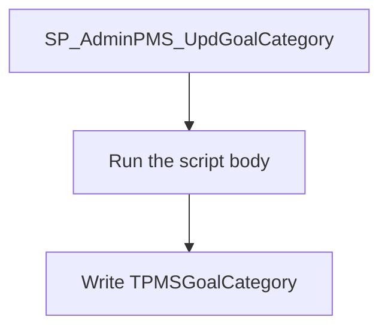

# SP_AdminPMS_UpdGoalCategory

## What it does

Runs SP_AdminPMS_UpdGoalCategory.

## Parameters

| Name | Direction | What it is for |
|---|---|---|
| `@Categoryid` | in | Categoryid |
| `@CategoryName` | in | Category Name |
| `@Employerid` | in | Employerid |
| `@IsActive` | in | Is Active |
| `@ModifiedBy` | in | Modified By |
| `@IsMeasureValAvailable` | in | Is Measure Val Available. Default 0 |
| `@MeasurementValue` | in | Measurement Value. Default 0 |
| `@CategoryType` | in | Category Type. Default 'K' |

## Call sequence

Calls no other procedures or functions.

## Callers

No other procedure or function calls this object.

## Nested

Calls no other procedures or functions.

## Steps

Script: `HRMS-DATABASE/HRMS/STOREPROCEDURE/SP_AdminPMS_UpdGoalCategory.sql`.

1. If (((Select Count(1) From TPMSGoalCategory Where Employerid=@Employerid And Upper(CategoryName)=Upper(@CategoryName) And IsDeleted=0 and Categoryid<>@Categoryid)>0)
2. Select 0 ErrorCode
3. Update TPMSGoalCategory
4. Select 1 ErrorCode

## Tables

| Table | Read or write |
|---|---|
| `TPMSGoalCategory` | read/write |
| `TPMSEmployeeGoals` | read |

## Flow

